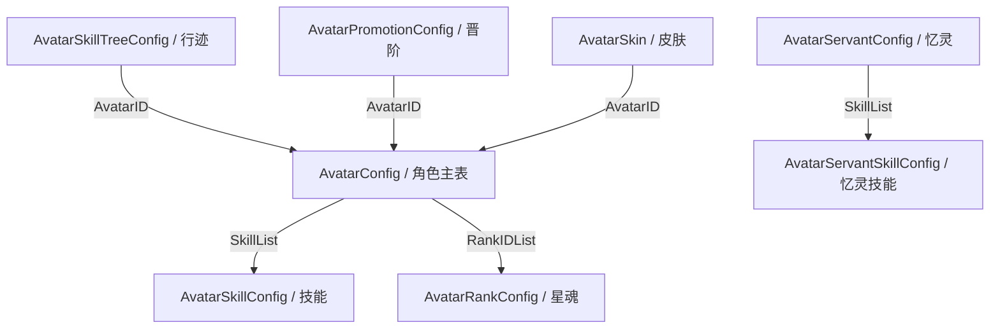
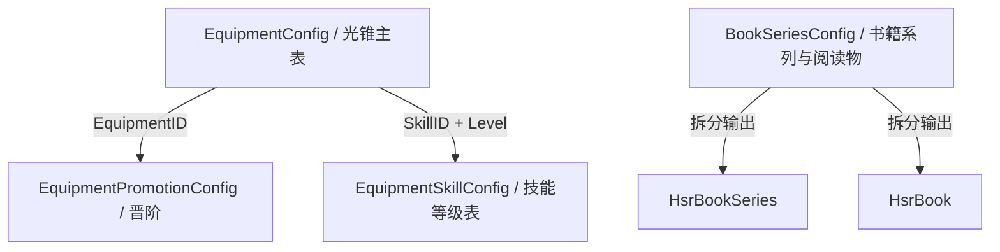
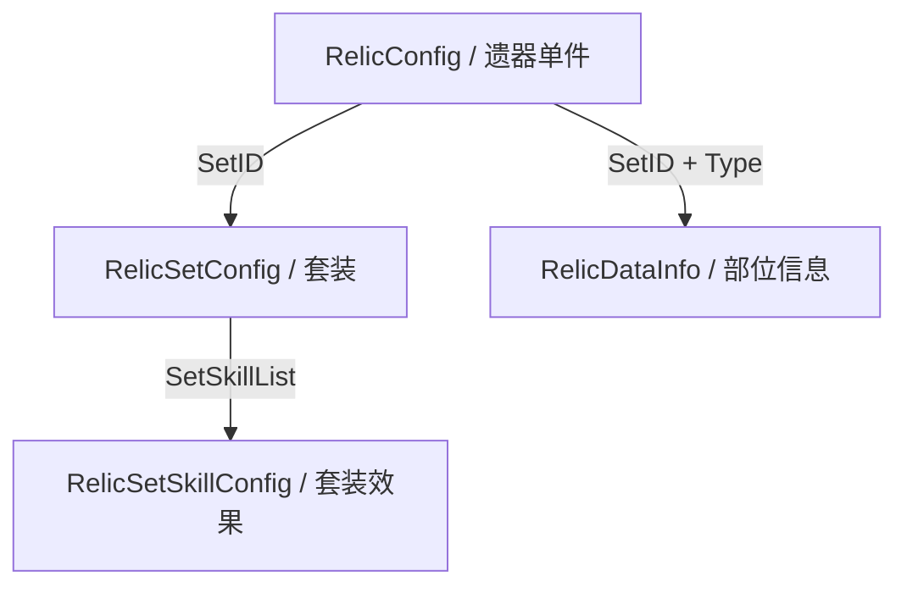
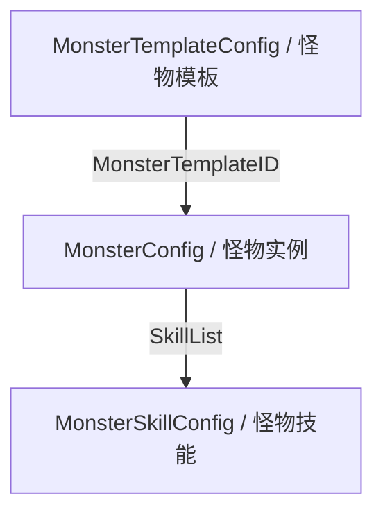
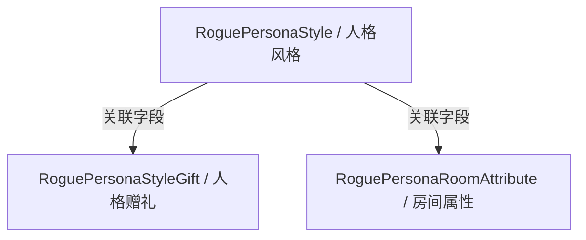

# HSR Schema 与类型映射文档

> 更新于 2026-09-26，基于 `packages/cli-hsr/schema/` 和 `packages/gacha-game-types/src/games/hsr/`

---

## 目录

- [1. Schema 表总览](#1-schema-表总览)
- [2. 复杂表关系图](#2-复杂表关系图)
- [3. Schema → 输出类型映射](#3-schema--输出类型映射)
- [4. 基础类型表](#4-基础类型表)
- [5. 提取器注册表](#5-提取器注册表)

---

## 1. Schema 表总览

`schema/` 目录下的文件镜像了 `ExcelOutput/*.json` 的原始结构，字段名保持原样（含混淆字段）。分组按**数据域**划分，而不是提取逻辑主题。

### 角色与养成

| Schema 文件 | 接口名 | 字段数 | 主键 | 说明 |
|---|---|---|---|---|
| `AvatarConfig` | `AvatarConfig` | 60 | `AvatarID` | 角色主配置，继承 `AvatarConfigEnhanceableInfo` |
| `AvatarConfigEnhanced` | `AvatarConfigEnhanceableInfo` | 7 | `AvatarID` | 角色可增强信息基类 |
| `AvatarBaseType` | `AvatarBaseType` | 14 | `ID` | 命途/职业类型 |
| `AvatarSkillConfig` | `AvatarSkillConfig` | 48 | `SkillID` | 角色技能配置 |
| `AvatarSkillTreeConfig` | `AvatarSkillTreeConfig` | 28 | `PointID` | 行迹/天赋树 |
| `AvatarRankConfig` | `AvatarRankConfig` | 15 | `RankID` | 星魂/命座 |
| `AvatarPromotionConfig` | `AvatarPromotionConfig` | 27 | `AvatarID+Promotion` | 晋阶配置 |
| `AvatarPropertyConfig` | `AvatarPropertyConfig` | 15 | `PropertyType` | 属性定义 |
| `AvatarSkin` | `AvatarSkin` | 55 | `ID` | 角色皮肤 |
| `AvatarServantConfig` | `AvatarServantConfig` | 22 | `ServantID` | 忆灵配置 |
| `AvatarServantSkillConfig` | `AvatarServantSkillConfig` | 43 | `SkillID` | 忆灵技能 |

### 装备与物品

| Schema 文件 | 接口名 | 字段数 | 主键 | 说明 |
|---|---|---|---|---|
| `EquipmentConfig` | `EquipmentConfig` | 41 | `EquipmentID` | 光锥主配置 |
| `EquipmentSkillConfig` | `EquipmentSkillConfig` | 13 | `SkillID+Level` | 光锥技能（按等级） |
| `EquipmentPromotionConfig` | `EquipmentPromotionConfig` | 19 | `EquipmentID+Promotion` | 光锥晋阶 |
| `ItemConfig` | `ItemConfig` | 25 | `ID` | 通用物品配置 |
| `BookSeriesConfig` | `LocalbookConfig` | 22 | `BookID` | 阅读物/书籍 |

### 遗器

| Schema 文件 | 接口名 | 字段数 | 主键 | 说明 |
|---|---|---|---|---|
| `RelicConfig` | `RelicConfig` | 11 | `ID` | 遗器主配置 |
| `RelicSetConfig` | `RelicSetConfig` | 11 | `SetID` | 遗器套装 |
| `RelicSetSkillConfig` | `RelicSetSkillConfig` | 10 | `SetID+RequireNum` | 套装效果 |
| `RelicDataInfo` | `RelicDataInfo` | 8 | `SetID+Type` | 遗器部位信息 |
| `RelicBaseType` | `RelicBaseType` | 5 | `Type` | 遗器类型字典 |

### 敌人与战斗单位

| Schema 文件 | 接口名 | 字段数 | 主键 | 说明 |
|---|---|---|---|---|
| `MonsterConfig` | `MonsterConfig` | 41 | `MonsterID` | 怪物配置 |
| `MonsterTemplateConfig` | `MonsterAISkillSequenceItem` | 46 | `MonsterTemplateID` | 怪物模板（含 AI 行为） |
| `MonsterSkillConfig` | `MonsterSkillConfig` | 24 | `SkillID` | 怪物技能 |
| `HardLevelGroup` | `HardLevelGroup` | 10 | `HardLevelGroup+Level` | 敌人等级曲线（逐级一行，属性 Ratio） |
| `EliteGroup` | `EliteGroup` | 6 | `EliteGroup` | 精英战斗组修正（五个属性 Ratio） |
| `DamageType` | `DamageType` | 27 | `ID` | 属性/元素类型 |

### 挑战（逐光捡金）

| Schema 文件 | 接口名 | 字段数 | 主键 | 说明 |
|---|---|---|---|---|
| `ChallengeGroupConfig` | `ChallengeGroupConfig` | 15 | `GroupID` | 忘却之庭期配置（期名/天气记忆紊流/排期/TierceID；`ScheduleDataID` 空为固定内容，提取时过滤） |
| `ChallengeMazeConfig` | `ChallengeMazeConfig` | 23 | `ID`（层） | 忘却之庭每期每层（弱点/三星条件/Stage 引用/展示 Boss） |
| `ChallengeMazeGroupExtra` | `ChallengeMazeGroupExtra` | 2 | `GroupID` | 忘却之庭期海报背景图 |
| `ChallengeMazeTierce` | `ChallengeMazeTierce` | 15 | `PHFMCACHFIJ` | 忘却之庭星启第三节点配置（字段混淆，语义见设计文档 §2.1/§7） |
| `ChallengeTargetConfig` | `ChallengeTargetConfig` | 5 | `ID` | 星数目标（ROUNDS_LEFT / DEAD_AVATAR） |
| `ChallengeStoryGroupConfig` | `ChallengeStoryGroupConfig` | 12 | `GroupID` | 虚构叙事期配置（期名/天气/排期/TierceID） |
| `ChallengeStoryGroupExtra` | `ChallengeStoryGroupExtra` | 10 | `GroupID` | 虚构叙事期补充（主题 ThemeID、期级可选 buff `BuffList`、StoryType） |
| `ChallengeStoryMazeConfig` | `ChallengeStoryMazeConfig` | 21 | `ID`（层） | 虚构叙事每期每层（弱点/得分目标/Stage 引用/展示 Boss） |
| `ChallengeStoryMazeExtra` | `ChallengeStoryMazeExtra` | 4 | `ID`（层） | 层补充：回合上限 `TurnLimit`、通关分 `ClearScore`、战斗目标 `BattleTargetID` |
| `ChallengeStoryMazeTierce` | `ChallengeStoryMazeTierce` | 16 | `PHFMCACHFIJ` | 虚构叙事星启第三节点配置（字段混淆，含通关分/战斗目标，语义见设计文档 §2.2/§7） |
| `ChallengeStoryTargetConfig` | `ChallengeStoryTargetConfig` | 4 | `ID` | 得分目标（TOTAL_SCORE 阈值） |
| `ChallengeStoryTheme` | `ChallengeStoryTheme` | 7 | `ThemeID` | 虚构叙事主题配色（4 个颜色字段 + 2 个 prefab） |
| `ScheduleDataChallengeMaze` | `ScheduleDataChallengeMaze` | 3 | `ID` | 忘却之庭期开始/结束时间 |
| `ScheduleDataChallengeStory` | `ScheduleDataChallengeStory` | 3 | `ID` | 虚构叙事期开始/结束时间 |
| `ScheduleDataGlobal` | `ScheduleDataGlobal` | 5 | `ID` | 全局排期（期时间回退表，Begin/GlobalBegin 互斥取非空） |
| `ChallengeBossGroupConfig` | `ChallengeBossGroupConfig` | 12 | `GroupID` | 末日幻影期配置（期名/天气/排期/TierceID） |
| `ChallengeBossGroupExtra` | `ChallengeBossGroupExtra` | 10 | `GroupID` | 末日幻影期补充（三组可选 buff、展示位） |
| `ChallengeBossMazeConfig` | `ChallengeBossMazeConfig` | 23 | `ID`（层） | 末日幻影每期每层（弱点/目标/Stage 引用/水温） |
| `ChallengeBossMazeExtra` | `ChallengeBossMazeExtra` | 4 | `ID`（层） | 三节点展示 Boss（战斗 MonsterID 口径） |
| `ChallengeBossMazeTierce` | `ChallengeBossMazeTierce` | 14 | `PHFMCACHFIJ` | 末日幻影星启第三节点配置（字段混淆，语义见设计文档 §2.3/§7） |
| `ChallengeBossTargetConfig` | `ChallengeBossTargetConfig` | 4 | `ID` | 得分目标（TOTAL_SCORE 阈值） |
| `ScheduleDataChallengeBoss` | `ScheduleDataChallengeBoss` | 3 | `ID` | 期开始/结束时间 |
| `ChallengePeakGroupConfig` | `ChallengePeakGroupConfig` | 14 | `ID` | 异相仲裁期配置（期名/前置层 `PreLevelIDList`/Boss 层 `BossLevelID`/主题图/奖牌图标 `RankIconPathList`；无排期字段） |
| `ChallengePeakConfig` | `ChallengePeakConfig` | 8 | `ID`（层） | 异相仲裁每层（目标 `NormalTargetList` → BattleTargetConfig、弱点/Stage 引用/敌方特性/进度原值） |
| `ChallengePeakBossConfig` | `ChallengePeakBossConfig` | 7 | `ID`（层） | Boss 层绝境难度（绝境层名/可选增益 `BuffList`/绝境 Stage 与特性/评奖阈值） |
| `ChallengeBadgeConfig` | `ChallengeBadgeConfig` | 12 | `BadgeID` | 挑战徽章/奖牌（四模式共用；异相仲裁取 `Type=Peak` 行，DummyDll 未收录 Row 类型） |
| `BattleTargetConfig` | `BattleTargetConfig` | 16 | `ID` | 战斗目标（多玩法共用；异相仲裁目标在 `Type=ChallengeTarget` 行，回合上限/死亡数） |
| `MazeBuff` | `MazeBuff` | 20 | `ID` | 关卡 buff（天气/水温/可选增益，四模式共用） |
| `StageConfig` | `StageConfig` | 7（子集） | `StageID` | 关卡（展示名 Hash/波次/等级/曲线分组/战斗组，仅镜像所需字段子集；Peak 以展示名反查预览首领） |

枚举（`schema/enum/`）：`ChallengeGroupType`（Memory/Story/Boss）、`ChallengeStoryType`（Normal/Fever）、`ChallengeTargetType`（ROUNDS_LEFT/DEAD_AVATAR/TOTAL_SCORE）。

### 世界、任务与文本

| Schema 文件 | 接口名 | 字段数 | 主键 | 说明 |
|---|---|---|---|---|
| `MainMission` | `MainMission` | 51 | `MainMissionID` | 主线任务 |
| `WorldDataConfig` | `WorldDataConfig` | 21 | `ID` | 世界/地图配置 |
| `Performance` | `PerformanceA`, `PerformanceC`, `PerformanceD`, `PerformanceDS`, `PerformanceE` | 8 / 8 / 11 / 11 / 11 | `PerformanceID` | 演出注册表族；C 复用 A 定义，DS 复用 D 定义 |
| `TalkSentenceConfig` | `TalkSentenceConfig` | 4 | `TalkSentenceID` | 对话台词文本字典 |
| `TextJoinConfig` | `TextJoinConfig` | 8 | `TextJoinID` | 动态文本拼接 |
| `NounAtlas` | `NounAtlas` | 10 | `ID` | 智库词条 |

### Rogue / 模拟宇宙体系

| Schema 文件 | 接口名 | 字段数 | 主键 | 说明 |
|---|---|---|---|---|
| `RogueRoomType` | `RogueRoomType` | 44 | `RogueRoomType` | 模拟宇宙房间类型 |
| `RogueMiracle` | `RogueMiracle` | 4 | `MiracleID` | 模拟宇宙奇物（短自增 ID） |
| `RogueMiracleDisplay` | `RogueMiracleDisplay` | 5 | `MiracleDisplayID` | 模拟宇宙奇物展示（与主表 DisplayID 关联） |
| `RogueMiracleEffect` | `RogueMiracleEffect` | 4 | `MiracleEffectID` | 奇物效果（Tourn 主表 EffectID 也引用） |
| `RogueMiracleEffectDisplay` | `RogueMiracleEffectDisplay` | 5 | `MiracleEffectDisplayID` | 奇物效果展示 |
| `RogueHandbookMiracle` | `RogueHandbookMiracle` | 6 | `MiracleHandbookID` | 模拟宇宙奇物图鉴 |
| `RogueHandbookMiracleType` | `RogueHandbookMiracleType` | 4 | `RogueHandbookMiracleType` | 奇物图鉴分类 |
| `RoguePersonaStyle` | `RoguePersonaStyle_V4_1` | 46 | 混淆字段 | 差分宇宙人格风格 |
| `RoguePersonaStyleGift` | `RoguePersonaStyleGift_V4_1` | 35 | 混淆字段 | 人格赠礼 |
| `RoguePersonaRoomAttribute` | `RoguePersonaRoomAttribute_V4_1` | 27 | 混淆字段 | 房间属性 |
| `RogueTournTitanType` | `RogueTournTitanType` | 11 | `RogueTitanType` | 差分宇宙泰坦类型 |
| `RogueTournMiracle` | `RogueTournMiracle` | 6 | `MiracleID` | 差分宇宙奇物运行时表（含变体） |
| `RogueTournHandbookMiracle` | `RogueTournHandbookMiracle` | 5 | `HandbookMiracleID` | 差分宇宙奇物图鉴（展示列表以本表为准） |
| `RogueTournHandBookEvent` | `RogueTournHandBookEvent` | 8 | `EventHandbookID` | 差分宇宙事件图鉴与 NPC 进度关联 |
| `RogueTournNPC` | `RogueTournNPC` | 2 | `RogueNPCID` | NPC 配置路径，供后续剧情关联 |
| `RogueTournContentDisplay` | `RogueTournContentDisplay` | 2 | `DisplayID` | 差分宇宙分类与解锁提示等展示文本 |
| `RogueImage` | `RogueImage` | 6 | `ImageID` | 模拟宇宙共用图片配置 |
| `RogueTournMiracleDisplay` | `RogueTournMiracleDisplay` | 5 | `MiracleDisplayID` | 差分宇宙奇物展示（4 位 ID） |

### 活动玩法

| Schema 文件 | 接口名 | 字段数 | 主键 | 说明 |
|---|---|---|---|---|
| `ActivityDiceAvatarConfig` | `ActivityDiceAvatarConfig` | 24 | `DiceAvatarID` | 银河战力党角色 |
| `ActivityDiceShopConfig` | `ActivityDiceShopConfig` | 15 | `DiceShopID` | 银河战力党商店 |
| `ActivityDiceSkill` | `ActivityDiceSkill_V4_0` | 28 | 混淆字段 | 银河战力党技能 |

---

## 2. 复杂表关系图

仅展示多表聚合、双向/反向挂载、以及带特殊处理的复杂关系。基础继承关系与简单字典依赖见后文表格。

### 角色与养成

### 装备与物品

### 遗器

### 敌人与战斗单位

### Rogue / 模拟宇宙体系

---

## 3. Schema → 输出类型映射

Schema 文件（原始 `ExcelOutput` 镜像）经过 Extractor 处理后，映射为 `gacha-game-types` 中定义的输出类型。分组按**数据域**整理，图表之外的基础类型关系统一在“继承/基础类型”列中列出。

### 角色与养成

| Schema | 输出类型 | 继承 / 基础类型 | 说明 |
|---|---|---|---|
| `AvatarConfig` | `HsrGameAvatar` | `HsrGameAvatarSimple` → `HsrItem` → `IMetadataEntity<number>` → `IEntity<number>` | 角色主实体 |
| `AvatarConfig`（子视图） | `HsrGameAvatarSimple` | `HsrItem` → `IMetadataEntity<number>` → `IEntity<number>` | 角色简要信息 |
| `AvatarServantConfig` | `HsrGameServant` | `HsrGameServantSimple` → `IMetadataEntity<number>` → `IEntity<number>` | 忆灵 |
| `AvatarSkillConfig` | `HsrAvatarSkill` | `IMetadataEntity<number>` → `IEntity<number>` | 角色技能 |
| `AvatarSkillTreeConfig` | `HsrAvatarSkillTree` | `IMetadataEntity<number>` → `IEntity<number>` | 行迹节点 |
| `AvatarRankConfig` | `HsrAvatarRank` | `IMetadataEntity<number>` → `IEntity<number>` | 星魂 |
| `AvatarPromotionConfig` | `HsrAvatarPromotion` | 无继承 | 晋阶数据 |
| `AvatarSkin` | `HsrGameAvatarSkin` | `HsrItem` → `IMetadataEntity<number>` → `IEntity<number>` | 皮肤 |
| `AvatarBaseType` | *(字典项)* | `IMetadataEntity<number>` → `IEntity<number>` | 命途字典 |
| `AvatarPropertyConfig` | `HsrProperty` | `IMetadataEntity<string>` → `IEntity<string>` | 属性字典 |

### 装备与物品

| Schema | 输出类型 | 继承 / 基础类型 | 说明 |
|---|---|---|---|
| `EquipmentConfig` | `HsrLightcone` | `HsrLightconeSimple` → `HsrItem` → `IMetadataEntity<number>` → `IEntity<number>` | 光锥主实体 |
| `EquipmentSkillConfig` | `HsrLightconeSkill` | `IMetadataEntity<number>` → `IEntity<number>` | 光锥技能 |
| `EquipmentPromotionConfig` | *(嵌入 `HsrLightcone`)* | 无继承 | 光锥晋阶 |
| `ItemConfig` | `HsrItemConfig` | `HsrItem` → `IMetadataEntity<number>` → `IEntity<number>` | 通用物品 |
| `BookSeriesConfig`（书籍） | `HsrBook` | `HsrItemConfig` → `HsrItem` → `IMetadataEntity<number>` → `IEntity<number>` | 阅读物 |
| `BookSeriesConfig`（系列） | `HsrBookSeries` | `HsrBookSeriesSimple` → `IMetadataEntity<number>` → `IEntity<number>` | 书籍系列 |
| `BookSeriesConfig`（地图信息） | `HsrBookSeriesWorld` | `IEntity<number>` | 书籍对应地图信息 |

### 遗器

| Schema | 输出类型 | 继承 / 基础类型 | 说明 |
|---|---|---|---|
| `RelicConfig` | `HsrRelic` | `HsrItem` → `IMetadataEntity<number>` → `IEntity<number>` | 遗器单件 |
| `RelicSetConfig` | `HsrRelicSet` | `HsrItem` → `IMetadataEntity<number>` → `IEntity<number>` | 遗器套装 |
| `RelicSetSkillConfig` | `HsrRelicSetBonus` | 无继承 | 套装效果 |
| `RelicDataInfo` | `HsrRelicInfo` | `IMetadataEntity<string>` → `IEntity<string>` | 遗器部位 |
| `RelicBaseType` | `HsrRelicType` | `IMetadataEntity<string>` → `IEntity<string>` | 遗器类型 |

### 敌人与战斗单位

| Schema | 输出类型 | 继承 / 基础类型 | 说明 |
|---|---|---|---|
| `MonsterConfig` | `HsrMonster` | `IMetadataEntity<number>` → `IEntity<number>` | 怪物实例 |
| `MonsterTemplateConfig` | `HsrMonsterTemplate` | `IMetadataEntity<number>` → `IEntity<number>` | 怪物模板 |
| `MonsterSkillConfig` | `HsrMonsterSkill` | `IEntity<number>`（结构型） | 怪物技能子表 |
| `HardLevelGroup` | `HsrHardLevelGroupDict` | 字典对象（`HsrBattleGroup.ts`，无继承） | 等级曲线分组 → `monster/hardLevelGroup.json` |
| `EliteGroup` | `HsrEliteGroupDict` | 字典对象（`HsrBattleGroup.ts`，无继承） | 精英组修正 → `monster/eliteGroup.json` |
| `DamageType` | *(字典项)* | `IMetadataEntity<number>` → `IEntity<number>` | 属性/元素字典 |

### 挑战（逐光捡金）

| Schema | 输出类型 | 继承 / 基础类型 | 说明 |
|---|---|---|---|
| `ChallengeGroupConfig` + 关联表 | `HsrChallengeMazeSeason` | extends `HsrChallengeSeasonBase`（`IMetadataEntity<number>`） | 混沌回忆期 → `challenge/maze/`（明细拆分；期时间 ScheduleDataChallengeMaze → ScheduleDataGlobal 回退） |
| `ChallengeMazeConfig` 等 | `HsrChallengeMazeFloor` | extends `HsrChallengeFloor` | 混沌回忆层（含 starTargets 与可选 tierce） |
| `ChallengeStoryGroupConfig` + 关联表 | `HsrChallengeStorySeason` | extends `HsrChallengeSeasonBase` | 虚构叙事期 → `challenge/story/`（明细拆分；themeId/themeColors、期级单组可选 buff） |
| `ChallengeStoryMazeConfig` 等 | `HsrChallengeStoryFloor` | extends `HsrChallengeFloor` | 虚构叙事层（turnLimit/clearScore/battleTargets/scoreTargets 与可选 tierce） |
| `ChallengeBossGroupConfig` + 关联表 | `HsrChallengeBossSeason` | extends `HsrChallengeSeasonBase`（`IMetadataEntity<number>`） | 末日幻影期 → `challenge/boss/`（明细拆分） |
| `ChallengeBossMazeConfig` 等 | `HsrChallengeBossFloor` | extends `HsrChallengeFloor` | 末日幻影层（含 scoreTargets） |
| `ChallengePeakGroupConfig` + 关联表 | `HsrChallengePeakSeason` | extends `HsrChallengeSeasonBase` | 异相仲裁期 → `challenge/peak/`（明细拆分；无排期 beginTime/endTime 缺省；badges 奖牌行；可选增益插件复用 selectableBuffs 单组） |
| `ChallengePeakConfig` + `ChallengePeakBossConfig` | `HsrChallengePeakFloor` | extends `HsrChallengeFloor` | 异相仲裁层（progressValues/hpProgressValues 原值、targets、Boss 层 isBoss + hard 绝境结构） |
| `ChallengeBadgeConfig` | `HsrChallengeBadge` | 结构型（`challenge/HsrChallengePeak.ts`） | 奖牌（level/name/icon） |
| `StageConfig` / `MonsterConfig` / 曲线表 | `HsrChallengeStage` / `HsrChallengeEnemy` / `HsrChallengeNode` | 结构型（`challenge/index.ts`） | 波次展开与 HP 计算的公共子类型 |
| `MazeBuff` | `HsrChallengeBuff` | 结构型 | buff（文本+图标+参数） |
| `ChallengeTargetConfig` / `ChallengeStoryTargetConfig` / `ChallengeBossTargetConfig` / `BattleTargetConfig` | `HsrChallengeTarget` | 结构型 | 星数/得分目标（异相仲裁目标在 BattleTargetConfig，type ← AbilityName、param ← TargetParam） |
| *(公共模型)* | `HsrChallengeAppearance` / `HsrChallengeAppearances` | 结构型 | 语言无关出场索引（第四步使用） |

### 世界、任务与文本

| Schema | 输出类型 | 继承 / 基础类型 | 说明 |
|---|---|---|---|
| `MainMission` | `HsrMainMission` | `IMetadataEntity<number>` → `IEntity<number>` | 主线任务 |
| `WorldDataConfig` | `HsrWorldData` | `IMetadataEntity<number>` → `IEntity<number>` | 世界数据 |
| `PerformanceA` | `HsrPerformanceA` | `HsrPerformanceBase<"A">` → `HsrPerformanceIndex<"A">` → `IEntity<number>` | A 类演出索引 |
| `PerformanceC` | `HsrPerformanceC` | `HsrPerformanceBase<"C">` → `HsrPerformanceIndex<"C">` → `IEntity<number>` | C 类 Story 演出索引；Schema 复用 A 定义 |
| `PerformanceD` | `HsrPerformanceD` | `HsrPerformanceBase<"D">` + `HsrPerformanceCharacterFields` | D 类 Act 演出索引，包含角色与可选 Group |
| `PerformanceDS` | `HsrPerformanceDS` | `HsrPerformanceBase<"DS">` + `HsrPerformanceCharacterFields` | DS 类 Discussion 演出索引；Schema 复用 D 定义 |
| `PerformanceE` | `HsrPerformanceE` | `HsrPerformanceBase<"E">` + `HsrPerformanceCharacterFields` | E 类演出索引，包含开场对白标记 |
| `PerformanceA/C/D/DS/E`（聚合视图） | `HsrPerformance` | 以上五种输出的判别联合 | 通过 `type` 收窄；记录身份必须使用 `type + id` |
| `TalkSentenceConfig` | `HsrTalkSentence` | `IEntity<number>` | `TalkSentenceID` 对应的说话人、正文和可选 Voice ID |
| `TextJoinConfig` | `HsrTextJoin` | `IEntity<number>`（结构型） | 动态文本 |
| `NounAtlas` | `HsrNounDesc` | `IMetadataEntity<number>` → `IEntity<number>` | 智库词条 |

#### Performance 输出布局

- `scenario/performance/a.json`、`c.json`、`d.json`、`ds.json`、`e.json`：按来源表保存完整的 `HsrPerformance*` 记录。
- `scenario/performance/index.json`：全表聚合的最小索引，每项仅保留 `id`、`type`、`path`。
- `scenario/talksentence.json`：与 Performance 独立的对话台词字典，不与演出记录合并。
- 不同 Performance 表允许出现相同 ID；消费者不得只用 `id` 建立全局字典，应使用 `type + id` 作为复合身份。
- Optional 字段表示原始 JSON 未序列化该值；Extractor 不使用 DummyDll 中的 CLR 默认值补齐。

### Rogue / 模拟宇宙体系

| Schema | 输出类型 | 继承 / 基础类型 | 说明 |
|---|---|---|---|
| `RoguePersonaStyle` | `HsrRoguePersona` | `IMetadataEntity<number>` → `IEntity<number>` | 人格风格 |
| `RoguePersonaStyleGift` | `HsrRoguePersonaGift` | `IMetadataEntity<number>` → `IEntity<number>` | 人格赠礼 |
| `RoguePersonaRoomAttribute` | `HsrRogueRoomAttribute` | `IMetadataEntity<number>` → `IEntity<number>` | 房间属性 |
| `RogueRoomType` | `HsrRogueRoomCompType` | `IMetadataEntity<number>` → `IEntity<number>` | 模拟宇宙房间类型 |
| `RogueTournTitanType` | `HsrRogueTitan` | `IMetadataEntity<number>` → `IEntity<number>` | 差分宇宙泰坦类型 |
| `RogueTournHandbookMiracle` + `RogueTournMiracle` + Display + `RogueMiracleEffect` | `HsrRogueMiracle`（含 `effect: HsrRogueMiracleEffect`） | `IMetadataEntity<number>` → `IEntity<number>` | 差分宇宙奇物图鉴列表（过滤变体/无分类）；效果经 MiracleEffectID 1:1 嵌入 |
| `RogueTournHandBookEvent` + `RogueTournNPC` + `RogueTournContentDisplay` + `RogueImage` | `HsrRogueTournEvent` | `IMetadataEntity<number>` | 事件列表及全部 NPC 配置入口；见 [入口说明](../../scenario-parser/docs/rogue-tourn-event-entry.md) |

### 活动玩法

| Schema | 输出类型 | 继承 / 基础类型 | 说明 |
|---|---|---|---|
| `ActivityDiceAvatarConfig` | `HsrDiceAvatar` | `HsrDiceAvatarSimple` → `HsrItem` → `IMetadataEntity<number>` → `IEntity<number>` | 银河战力党角色 |
| `ActivityDiceShopConfig` | `HsrDiceShopGood` | 无继承 | 银河战力党商品 |
| `ActivityDiceSkill` | `HsrDiceAvatarSkill` | 无继承 | 银河战力党技能 |

---

## 4. 基础类型表

基础类型信息全部改为表格列出，避免在 Mermaid / classDiagram 中堆叠过多简单继承，减少解析错误与视觉噪音。

### 基础实体接口

| 类型 | 定义位置 | 关键字段 | 说明 |
|---|---|---|---|
| `IEntity<K = string>` | `packages/gacha-game-types/src/common/IEntity.ts` | `id: K` | 最基础实体接口 |
| `IMetadataEntity<K = string>` | `packages/gacha-game-types/src/common/IEntity.ts` | `id: K`, `code?: string`, `name: string`, `icon?: string` | 继承 `IEntity<K>`，增加展示元信息 |

### 常用中间类型

| 类型 | 定义位置 | 继承 / 组合 | 关键字段 | 说明 |
|---|---|---|---|---|
| `HsrItem` | `packages/gacha-game-types/src/games/hsr/HsrItem.ts` | `IMetadataEntity<number>` | `icon`, `rarity` | 大部分可展示物品/实体的基础类型 |
| `HsrItemConfig` | `packages/gacha-game-types/src/games/hsr/HsrItem.ts` | `HsrItem` | `desc`, `text`, `type`, `subType`, `inventoryGroup`, `itemGroup` | 物品配置型基础结构 |
| `HsrProperty` | `packages/gacha-game-types/src/games/hsr/HsrItem.ts` | `IMetadataEntity<string>` | `visible`, `order`, `group`, `isPercent` | 属性字典项 |
| `HsrAvatarView` | `packages/gacha-game-types/src/games/hsr/HsrGameAvatar.ts` | 组合型 | `icon`, `roundIcon`, `portrait` | 角色展示视图片段 |
| `HsrGameAvatarSimple` | `packages/gacha-game-types/src/games/hsr/HsrGameAvatar.ts` | `HsrAvatarView` + `HsrItem` | `path`, `element`, `desc` | 角色简要实体 |
| `HsrGameServantSimple` | `packages/gacha-game-types/src/games/hsr/HsrGameAvatar.ts` | `IMetadataEntity<number>` | `icon`, `roundIcon` | 忆灵简要实体 |
| `HsrLightconeSimple` | `packages/gacha-game-types/src/games/hsr/HsrLightcone.ts` | `HsrItem` | `path`, `icon`, `portrait` | 光锥简要实体 |
| `HsrBookSeriesSimple` | `packages/gacha-game-types/src/games/hsr/HsrBook.ts` | `IMetadataEntity<number>` | `desc`, `num`, `world`, `visible`, `bookIds` | 书籍系列简要实体 |
| `HsrSkillLevel` | `packages/gacha-game-types/src/games/hsr/HsrItem.ts` | 结构型 | `level`, `params` | 技能等级参数通用结构 |
| `HsrItemCost` | `packages/gacha-game-types/src/games/hsr/HsrItem.ts` | 结构型 | `itemId`, `num` | 消耗项通用结构 |
| `HsrPerformanceIndex<T>` | `packages/gacha-game-types/src/games/hsr/HsrPerformance.ts` | `IEntity<number>` | `id`, `type`, `path` | Performance 最小查询记录 |
| `HsrPerformanceBase<T>` | `packages/gacha-game-types/src/games/hsr/HsrPerformance.ts` | `HsrPerformanceIndex<T>` | `sourceTable`, Plane/Floor、跳过与黑屏字段 | 五类演出输出的语义公共基类；不对应 CLR 继承 |
| `HsrPerformanceCharacterFields` | `packages/gacha-game-types/src/games/hsr/HsrPerformance.ts` | 组合型 | `performanceCharacter`, `changePlayerType` | D、DS、E 共享的角色字段 |

### 典型继承链示例

| 输出类型 | 继承链 |
|---|---|
| `HsrBook` | `HsrBook` → `HsrItemConfig` → `HsrItem` → `IMetadataEntity<number>` → `IEntity<number>` |
| `HsrLightcone` | `HsrLightcone` → `HsrLightconeSimple` → `HsrItem` → `IMetadataEntity<number>` → `IEntity<number>` |
| `HsrRelicSet` | `HsrRelicSet` → `HsrItem` → `IMetadataEntity<number>` → `IEntity<number>` |
| `HsrGameAvatar` | `HsrGameAvatar` → `HsrGameAvatarSimple` → `HsrItem` → `IMetadataEntity<number>` → `IEntity<number>` |
| `HsrGameServant` | `HsrGameServant` → `HsrGameServantSimple` → `IMetadataEntity<number>` → `IEntity<number>` |

---

## 5. 提取器注册表

`extract/index.ts` 中注册的提取流程（按执行顺序）：

| 顺序 | 提取器 | 入口函数 | 输出目录 | 涉及 Schema |
|---|---|---|---|---|
| 1 | 基础字典 | `extractDictData()` | `dict/` | `DamageType`, `AvatarBaseType`, `AvatarPropertyConfig`, `RelicBaseType`, `HardLevelGroup`, `EliteGroup` |
| 2 | 物品 | `extractItemsData()` | `item/` | `ItemConfig` |
| 3 | 角色/忆灵 | `extractAvatarData()` | `avatar/` | `AvatarConfig`, `AvatarSkillConfig`, `AvatarSkillTreeConfig`, `AvatarRankConfig`, `AvatarPromotionConfig`, `AvatarSkin`, `AvatarServantConfig`, `AvatarServantSkillConfig` |
| 4 | 光锥 | `extractLightconeData()` | `lightcone/` | `EquipmentConfig`, `EquipmentSkillConfig`, `EquipmentPromotionConfig` |
| 5 | 遗器 | `extractRelicData()` | `relic/` | `RelicConfig`, `RelicSetConfig`, `RelicSetSkillConfig`, `RelicDataInfo` |
| 6 | 智库 | `extractNouns()` | `databank/` | `NounAtlas` |
| 7 | 阅读物 | `extractBookData()` | `book/` | `BookSeriesConfig` |
| 8 | 银河战力党 | `extractDiceCombatData()` | `dicecombat/` | `ActivityDiceAvatarConfig`, `ActivityDiceShopConfig`, `ActivityDiceSkill` |
| 9 | 主线任务 | `extractMissionData()` | `mission/` | `MainMission`, `WorldDataConfig`, `SubMission` |
| 10 | 剧情索引与台词 | `extractScenarioData()` | `scenario/` | `PerformanceA/C/D/DS/E`, `TalkSentenceConfig` |
| 11 | 模拟宇宙 | `extractRogueData()` | `rogue/` | `RogueRoomType` |
| 12 | 差分宇宙 | `extractRogueTournData()` | `rogue/tourn/` | `RoguePersonaStyle`, `RoguePersonaStyleGift`, `RoguePersonaRoomAttribute`, `RogueTournTitanType`, `RogueTournMiracle`, `RogueTournHandbookMiracle`, `RogueTournMiracleDisplay`, `RogueMiracleDisplay`, `RogueMiracleEffect`, `RogueTournHandBookEvent`, `RogueTournNPC`, `RogueTournContentDisplay`, `RogueImage` |
| 13 | 敌人 | `extractMonsterData()` | `monster/` | `MonsterConfig`, `MonsterTemplateConfig`, `MonsterSkillConfig` |
| 14 | 逐光捡金 | `extractChallengeData()` | `challenge/<mode>/` | `ChallengeGroupConfig`, `ChallengeMazeConfig`, `ChallengeMazeGroupExtra`, `ChallengeMazeTierce`, `ChallengeTargetConfig`, `ChallengeStoryGroupConfig`, `ChallengeStoryGroupExtra`, `ChallengeStoryMazeConfig`, `ChallengeStoryMazeExtra`, `ChallengeStoryMazeTierce`, `ChallengeStoryTargetConfig`, `ChallengeStoryTheme`, `ChallengeBossGroupConfig`, `ChallengeBossGroupExtra`, `ChallengeBossMazeConfig`, `ChallengeBossMazeExtra`, `ChallengeBossMazeTierce`, `ChallengeBossTargetConfig`, `ScheduleDataChallengeMaze`, `ScheduleDataChallengeStory`, `ScheduleDataChallengeBoss`, `ScheduleDataGlobal`, `ChallengePeakGroupConfig`, `ChallengePeakConfig`, `ChallengePeakBossConfig`, `ChallengeBadgeConfig`, `BattleTargetConfig`, `MazeBuff`, `StageConfig` |
| 15 | 如我所书 | `extractTarotWikiData()` | `tarotwiki/` | `TarotWikiData`, `TarotWikiSubdata`, `TarotWikiChangeinfo`, `TarotWikiTimeline`, `TarotWikiUnlockConditions` |
| 16 | 动态文本 | `extractTextJoinData()` | `textjoin/` | `TextJoinConfig` |

补充说明：主线任务（第 9 项）在 `mission/` 下输出四个文件——`graph.json`（任务图，前端展示数据）、`worlds.json`（世界列表）、`submission.json`（子任务目标/描述）、`subowner.json`（`[子任务ID, 主任务ID]` 扁平数组，MissionInfo 权威归属口径，供 scenario-parser 等下游工具归属演出图文件，前端不加载）。

---

## 附录：混淆字段说明

部分 Schema（v4.0+ 新增）使用混淆后的随机字符串作为字段名，例如：

- `ActivityDiceSkill_V4_0`: `MPBBBEHANOJ`, `GDOLCABIKJI`, `FDKCKECMFHL`...
- `RoguePersonaStyle_V4_1`: `JGGMMHNKCEJ`, `NLAPOPICKMA`, `HIBCAPBAGMF`...
- `RoguePersonaStyleGift_V4_1`: `BOEBBBLHFKG`, `NJAPIHOAHAN`, `LEFKFFICGAI`...
- `RoguePersonaRoomAttribute_V4_1`: `FNHLKMBOLPD`, `NJAPIHOAHAN`, `INHDIFBOBFD`...
- `MonsterTemplateConfig`: `MNAHFIGOHML`...

这些字段在 Extractor 中通过上下文语义映射到输出类型的语义化字段名。Schema 中保持原始名称不动。

接口名带版本后缀（如 `_V4_0`、`_V4_1`）表示该表在对应版本引入混淆字段。无后缀的为传统命名。
