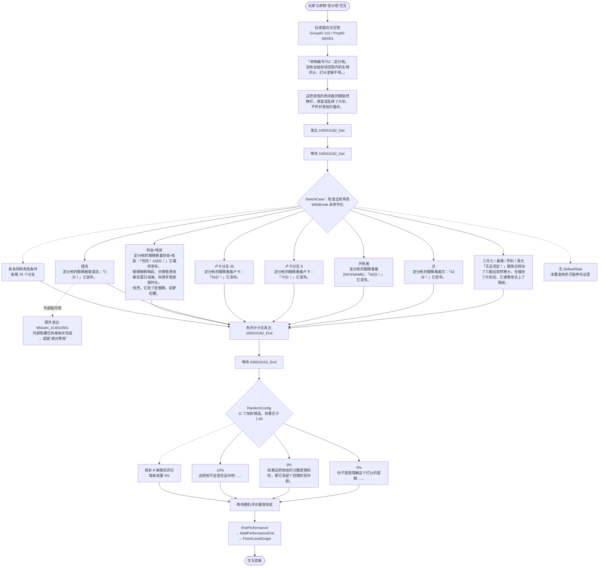

# Act100010162「定分枪」数据关联实测报告

> 实测日期：2026-09-01  
> 案例源文件：`Config/Level/NPCDialogue/P20002/F20002001_G7/Act/Act100010162.json`  
> 语言：CHS（简体中文）  
> 实验脚本：[parse.mjs](./parse.mjs)  
> 结构化产物：[output.chs.json](./output.chs.json)  
> 额外评分对照：[character-score-table.md](./character-score-table.md)

## 1. 结论

本案例能够依赖 TurnBasedGameData 中的 JSON、cli-hsr 已处理 CHS 输出和现有 DummyDll 类型信息，还原出一份前端可直接读取的简化剧情结构。实际产物成功关联了：

- `PerformanceE → Act 路径`；
- `Act 中 TalkSentenceID → cli-hsr 已生成 CHS talksentence`；
- `ByLocalPlayerAvatarID.AvatarIDs → cli-hsr 已合并角色输出`；
- `TriggerCustomString ↔ WaitCustomString` 形成的三个演出阶段；
- 镜流分支的 `Mission_414010501 → MainMission 4140105 → 成就“绝对零度”`；
- `RandomConfig.OddsList[index] ↔ TaskList[index]` 的随机候选关系；
- DummyDll 中的基类、声明字段与实例中实际序列化字段。

本次共解析 126 次台词引用、125 个不重复 `TalkSentenceID`，均成功得到 CHS 文案；85 个角色 ID 条件分支包含 87 个不重复角色 ID，另有 1 个开拓者条件分支，角色名称也全部解析成功。

案例同时证明：可读剧情不能只抽台词，也不能把源 JSON 直接当作树。至少需要保留事件总线、Predicate、容器类型、来源路径和未确定的运行时语义。

## 2. 实测输入与关联链

### 2.1 使用的数据

| 数据 | 本例用途 |
|---|---|
| `Config/Level/NPCDialogue/P20002/F20002001_G7/Act/Act100010162.json` | 演出图、角色条件、随机容器和生命周期 |
| `ExcelOutput/PerformanceE.json` | E 类演出的 ID/路径注册表，并提供 Plane、Floor、跳过、黑屏等播放元数据 |
| `packages/cli-hsr/output/CHS/scenario/talksentence.json` | 已完成 `TalkSentenceConfig + TextMapCHS` 关联的 CHS 台词字典 |
| `packages/cli-hsr/output/CHS/avatars/index.json` | 已合并的角色名称、属性、命途和基础展示数据 |
| `packages/cli-hsr/output/CHS/avatars/{id}.json` | 完整角色版本和技能；用于读取欢愉 `elationPriority` |
| `packages/cli-hsr/output/CHS/elements.json`、`paths.json` | 属性和命途代码的 CHS 名称 |
| `ExcelOutput/AchievementData.json`、`FinishWay.json`、CHS TextMap | 由隐藏任务反查“绝对零度”的名称、说明和完成条件；该域当前没有现成输出 |
| `Config/Level/Mission/4140105/*` | 接收镜流分支信号并完成隐藏任务 |
| `tool/scenario-type-scan/DummyDll/RPG.GameCore.Config.dll` | 本例相关 `$type` 的基类与声明字段 |
| `docs/scenario-type-inheritance-inventory.md` | 类型族和全量扫描背景 |

角色与台词优先读取 cli-hsr 已处理输出，不再在案例脚本中重复实现分表 join 和 TextMap 解析。只有尚无现成输出的 `AchievementData` 仍用 `json-bigint` 保真读取 Hash，再查 CHS TextMap。

### 2.2 Performance 与交互对象

`PerformanceE.json` 中存在唯一匹配项：

```text
PerformanceID = 100010162
PerformancePath = Config/Level/NPCDialogue/P20002/F20002001_G7/Act/Act100010162.json
PlaneID = 10001
FloorID = 10001001
```

Act 入口的 `AdvEntityFaceTo` 让本地玩家面向静态目标 `GroupID=102`、`ID=300001`。紧随其后的第一句文案明确写出“奇物编号 752：定分枪”，因而可以把这个 Prop 目标与本案例的“定分枪”交互对应起来。这里只能证明本次演出面对该 Prop；若正式输出需要 Prop 的展示名称，还应继续关联 Prop/地图实体配置，不能把台词内容当成实体主键。

### 2.3 PerformanceE 的功能与提取建议

`PerformanceE` 不是台词表，也不是剧情 AST；它更接近 E 类演出的注册索引。当前数据共有 12496 行，稳定主字段是：

- `PerformanceID`：演出 ID；
- `PerformancePath`：Act/Talk 等配置文件的真实路径；
- `PerformanceCharacter`：演出角色参数，本表每行都存在但经常为空；
- 可选 `PlaneID / FloorID`：演出所在地图；
- 可选 `IsSkip / IsIntroDialogue / StartBlack / EndBlack / EndWithCrack / ChangePlayerType`：跳过、开场对白、黑屏和玩家形态等播放属性。

本案例之所以能从 `100010162` 稳定定位到 NPCDialogue Act，依赖的就是 `PerformanceE.PerformancePath`。如果解析器已经从文件系统遍历到了这个 Act，缺少 `PerformanceE` 仍然能抽出台词；但会丢失 Performance ID、Plane/Floor 和播放元数据，也不容易从 ID 反向定位 NPC、Prop、Crowd 等任务外演出。

因此建议把它加入正式剧情提取目标，但不要与 `TalkSentenceConfig` 合并成同一种记录。`TalkSentenceConfig` 已经由 cli-hsr 生成 `scenario/talksentence.json`，本次不需要新增一份重复 Extractor；缺口是 Performance 索引输出：

| 建议输出 | 角色 |
|---|---|
| `scenario/talksentence.json` | 文本字典：`TalkSentenceID → speaker/text/voice` |
| `scenario/performance.json` 或同类索引 | 演出目录：`PerformanceType + PerformanceID → path/plane/floor/playback metadata` |
| 演出解析产物 | 从 `PerformancePath` 打开的图事件、可读分支和引用到的 TalkSentence |

当前案例只用到 E，但全量剧情不应只提取 `PerformanceE`。现有 Excel 还存在 `PerformanceA/C/D/DS` 等表，分别覆盖 Timeline、Story、Dialogue/Discussion 等来源；正式设计宜做“Performance 表族”的统一轻量索引，同时保留 `type` 和来源表，避免同 ID、不同 PerformanceType 被错误合并。

## 3. 实际还原出的交互流程

源文件有 4 个 `OnStartSequece`。它们不是简单依次串行，而是通过 CustomString 互相唤醒。

```text
初始化并面向 Prop
  → 播放 2 句介绍
  → emit 100010162_Get
  → wait 100010162_Get
  → SwitchCase：按当前角色播放评分
  → 每个角色分支 emit 100010162_End
  → wait 100010162_End
  → RandomConfig：播放随机内心评论
  → EndPerformance
  → WaitPerformanceEnd
  → FinishLevelGraph
```

### 3.1 开场

`PlaySimpleTalk` 播放 2 句文本，后接 `WaitSimpleTalkFinish`：

1. `100025001`：介绍“奇物编号 752：定分枪”；
2. `100025002`：定分枪睁眼并观察玩家。

随后 `TriggerCustomString("100010162_Get")` 唤醒角色评分 sequence。

### 3.2 角色评分分支

`SwitchCase.TaskList` 一共有 86 项：

- 85 项使用 `ByLocalPlayerAvatarID`；
- 这些条件包含 88 次 ID 出现、87 个不重复角色 ID；
- 1 项使用 `ByLocalPlayerIsHero`，覆盖当前为开拓者的情况，不在 JSON 中枚举开拓者的各命途/性别 ID；
- 没有序列化 `DefaultTask`。

单个角色条件可能包含多个 ID。例如第一个条件同时包含 `1001 / 1108 / 1203 / 1204`，四个角色共用“无法测定”文案。大多数后期角色有独立文案，部分角色有 2～3 句连续反应。

分支台词数量与播放方式如下：

| 分支形态 | 分支数 |
|---|---:|
| 1 句 `PlaySimpleTalk`，另接 `WaitSimpleTalkFinish` | 17 |
| 1 句 `PlayAndWaitSimpleTalk` | 46 |
| 2 句 `PlayAndWaitSimpleTalk` | 19 |
| 3 句 `PlayAndWaitSimpleTalk` | 4 |

两种播放 task 都继承 `SimpleTalkListConfig`，因此脚本共用同一个 `SimpleTalkList[].TalkSentenceID` handler，只在输出中保留 `play-without-wait` / `play-and-wait` 差异。

每个评分分支最终都会发出 `100010162_End`，从而启动随机评论阶段。

### 3.3 随机评论

`RandomConfig` 有 11 个 `OddsList` 和 11 个 `TaskList`，按数组索引一一对应：

- 前 10 项权重均为 `0.09`；
- 最后一项权重为 `0.10`；
- 权重合计为 `1.00`；
- 每个候选是一句 `PlaySimpleTalk`，文本是玩家对打分逻辑的随机猜测或吐槽。

DummyDll 表明 `RandomConfig : CompositeConfig` 还声明了 `RandomCount`、`RandomUnique`、`ContinuousNotRepeat`、RandomMask 等字段。本实例没有序列化 `RandomCount` 等字段，因此实验产物只保存“加权候选”而不自行模拟运行时抽取次数。这能满足前端展示，也避免把构造默认值猜成源数据事实。

## 4. 关键发现

### 4.1 类型信息会改变对实例的解释

本例实际用到的关键类型关系包括：

| 类型 | 基类 | 本例读取的语义字段 |
|---|---|---|
| `PlaySimpleTalk` | `SimpleTalkListConfig` | `SimpleTalkList[].TalkSentenceID` |
| `PlayAndWaitSimpleTalk` | `SimpleTalkListConfig` | `SimpleTalkList[].TalkSentenceID` |
| `SwitchCase` | `TaskConfig` | `TaskList[].Predicate/SuccessTaskList` |
| `ByLocalPlayerAvatarID` | `PredicateConfig` | `AvatarIDs` |
| `ByLocalPlayerIsHero` | `PredicateConfig` | 无新增字段，由类型本身表达条件 |
| `RandomConfig` | `CompositeConfig` | `OddsList[]`、`TaskList[]` |
| `TriggerCustomString` / `WaitCustomString` | `TaskConfig` | `CustomString.Value` |

特别是 DummyDll 显示 `SwitchCase` 声明了 `WithBreak`、`TaskList` 和 `DefaultTask`。本实例只序列化了 `TaskList`，不能从 JSON 单独断定它是“首个条件命中后停止”还是“执行所有命中项”。因此产物保留源顺序、所有分支以及 `serializedWithBreak: null`，没有提前压成互斥字典。

### 4.2 源数据确有重复角色条件

角色 `1111`（卢卡）出现两次：

- 分支 9：`100025012`，评分 75；
- 分支 26：`100025045`，评分 55。

这不是重复台词 ID，而是同一 Predicate 对应两套不同文案。实际会显示一条还是两条依赖 `WithBreak` 的运行时默认值；现有 JSON 和无方法体的 DummyDll 无法完成最终判定。正式解析器不能静默去重，也不应擅自选择“较新”的后一个分支。

另有一处真正的台词复用：`100025003` 同时用于第一组四角色和角色 `1224`，所以本例有 126 次台词引用但只有 125 个不重复 ID。

### 4.3 镜流外部事件就是“绝对零度”成就链

角色 `1212`（镜流）的分支除了播放“0 分”文案和发出 `100010162_End`，还额外发出：

```text
Mission_414010501
```

当前 Act 内确实没有对应的 `WaitCustomString`，但全局追踪后能得到完整的直接配置链：

```text
镜流评分分支
  → TriggerCustomString("Mission_414010501")
  → Config/Level/Mission/4140105/Mission_414010501.json
  → WaitCustomString("Mission_414010501")
  → FinishPerformanceMission(Key="Mission_414010501")
  → 完成 SubMission 414010501 / MainMission 4140105
  → FinishWay 4082703: FinishMission [4140105]
  → AchievementData 4082703
     标题：“绝对零度”
     说明：“使用镜流与定分枪互动”
```

所以它不只是“可能与成就有关”，而是成就触发的直接中间信号。`AchievementData` 自身不引用镜流或 Act；真正的语义连接藏在 `TriggerCustomString → 隐藏 PerformanceMission → FinishWay` 三段关系里。只抽台词、只抽 AchievementData，或只在当前 Act 内匹配 Wait，都会漏掉这条边。

实验产物现已把该链写入 `case.externalAssociations`，event bus 事件也带有 `externalConsumer`，不再只标记成未知副作用。

### 4.4 案例解析应复用 cli-hsr 的合并角色输出

以下 4 个 Act 角色 ID 在 `AvatarConfig.json` 中不存在，但在 `AvatarConfigLD.json` 中存在：

| AvatarID | CHS 名称 |
|---:|---|
| 1014 | Saber |
| 1015 | Archer |
| 1508 | 远坂凛 |
| 1509 | 吉尔伽美什 |

只读常规角色表会得到 4 个“未知角色”，但这项合并工作已经由 `cli-hsr` 的 `AvatarExtractor` 完成。案例脚本没有必要再次复刻 `AvatarConfig + AvatarConfigLD + TextMap` 的规则，现已改为直接读取：

- `output/CHS/avatars/index.json`：统一的 ID、CHS 名称、属性、命途；
- `output/CHS/avatars/{id}.json`：完整 `versions`、技能及欢愉参演编号；
- `output/CHS/elements.json`、`paths.json`：属性和命途的 CHS 显示名。

这样联动角色与普通角色在场景解析层没有区别，也避免未来 AvatarExtractor 调整分表规则后，scenario-parser 还保留一套过期实现。正式流水线应明确任务依赖：先生成 cli-hsr 的 CHS 角色/台词字典，再生成面向前端的剧情关联产物；若以后需要多语言，则按相同语言目录读取对应输出。

同样的原则也已用于台词：案例脚本现在读取 `output/CHS/scenario/talksentence.json`，不再重复读取 43 MiB 的 `TalkSentenceConfig` 和 50 MiB 的 TextMap 来完成已存在的 join。原始 Hash 关联仍由 cli-hsr 的 TalkSentence Extractor 负责；场景产物只需要保留台词 ID、CHS 文本、说话人和 VoiceID。

### 4.5 文本还含前端需要处理的运行时语法

本例说话人 Hash 解析结果均为空，内容属于无说话人旁白；角色名称直接写在正文中。正文保留了：

- `<unbreak>...</unbreak>` Unity 富文本标签；
- `{NICKNAME}` 玩家昵称占位符；
- 全角标点和特殊中点字符。

实验产物不做破坏性清洗。前端可以选择渲染、转义或提供纯文本派生值，但原始 CHS 文本应保留。

### 4.6 没有默认角色分支

`SwitchCase.DefaultTask` 未序列化。当前文件覆盖了大量角色，但未来新增角色若未同步追加 Predicate，理论上可能无法发出 `100010162_End`，导致随机评论 sequence 一直等待。前端可以显示“无显式默认分支”的诊断；解析器不应自动合成一个分支。

## 5. 角色评分对照（额外产出）

完整的 88 行角色属性、命途、评分、“无法测定”状态及欢愉参演编号已拆分到独立文档：[character-score-table.md](./character-score-table.md)。主报告只保留数据关联、控制流和正式实现指导。

## 6. 结构化产物说明

产物顶层分为五个主要部分：

| 字段 | 内容 |
|---|---|
| `case` | 来源 Act、Performance、Plane/Floor、面对的 Prop，以及“绝对零度”外部关联链 |
| `typeCatalog` | 本例使用的类型族、基类、声明字段子集与实际解释字段 |
| `characterScoreTable` | 88 个交互角色维度的属性、命途、评分、无法测定状态和欢愉参演编号 |
| `flow` | `intro → character-score → random-comment → finish` 四阶段及 event bus |
| `diagnostics` | 类型计数、分支数、引用覆盖、重复条件、未解析项和风险提示 |

每条台词包含：

```json
{
  "id": 100025016,
  "speaker": null,
  "text": "定分枪的眼睛看着{NICKNAME}：「<unbreak>84</unbreak>分！」它宣布。",
  "source": {
    "output": "packages/cli-hsr/output/CHS/scenario/talksentence.json",
    "voiceId": null
  }
}
```

角色分支同时保留 `condition`、已解析角色、对白块、是否显式等待、发出的信号和源 task 类型。前端无需重新读取 GameCore 原始 JSON 就可以：

- 展示开场与随机评论；
- 按角色 ID 或名称选择评分分支；
- 展示一个角色的多句反应；
- 标注未知运行时语义和外部副作用；
- 在调试页追溯 TalkSentenceID 与上游 cli-hsr 输出。

## 7. 自动校验结果

脚本运行时包含以下断言，本次全部通过：

- Act 中恰有 1 个 `SwitchCase` 和 1 个 `RandomConfig`；
- 能找到 `100010162_Get` 与 `100010162_End` 的 Wait 节点；
- `RandomConfig.OddsList.length === TaskList.length`；
- 随机权重之和为 1；
- 每个角色评分分支都发出 `100010162_End`；
- 126 次台词引用均成功关联 CHS 文本；
- 87 个不重复角色 ID 均成功关联 CHS 名称。
- 评分表恰有 88 行，即 87 个不重复 AvatarID 加 1 个开拓者通用条件；
- 镜流信号能完整关联到 SubMission 414010501、MainMission 4140105 和成就 4082703“绝对零度”；
- 欢愉参演编号均从角色 `versions[0].skills` 读取，而不是从对白数字猜测。

Node 20.19.3 下，复用 cli-hsr 台词/角色输出并生成约 267 KiB JSON 用时约 2～3 秒。PATH 中旧 Node 14 对 ESM 与 `json-bigint` 的兼容性和性能均不满足本实验，本包已声明 Node 18 或更高版本。

运行方式（当前目录为 `packages/scenario-parser`）：

```powershell
node ./case-tests/act100010162/parse.mjs
```

也可以传入自定义输出路径：

```powershell
node ./case-tests/act100010162/parse.mjs ./tmp/act100010162.chs.json
```

## 8. 对正式实现的指导方向

1. **先定义事件 IR，再派生可读流程。** Talk、Predicate、Wait/Trigger、Random、生命周期和 opaque task 都应能独立保留；面向前端的 `flow` 是事件 IR 的一种视图，不是唯一真相。

2. **使用通用递归 walker + 少量语义 handler。** 本例只需处理 `SimpleTalkListConfig`、角色 Predicate、SwitchCase、RandomConfig 和 CustomString；未知对象继续递归并保留来源，不需要建立 466 类型 giant switch。

3. **将 DummyDll 类型目录作为构建期辅助。** 基类能让 `PlaySimpleTalk` 与 `PlayAndWaitSimpleTalk` 共享 handler，声明字段则能暴露本实例未序列化的 `WithBreak`、`DefaultTask`、`RandomCount`。运行时仍只读取 JSON。

4. **区分“字段缺失”和“值为默认值”。** 未序列化字段不能直接替换成猜测值。输出可用 `null + certainty` 表达本例的 `WithBreak` 和 `RandomCount`，必要时再通过客户端运行观察或更完整元数据确认。

5. **优先复用已有领域输出。** 角色分表合并、TextMap、属性和命途已经由 cli-hsr 处理，scenario-parser 应消费其语言化输出，而不是重做 `AvatarConfig + AvatarConfigLD` join。需要在构建流程中声明上游输出版本与生成顺序。

6. **保留控制副作用。** 镜流分支的 `Mission_414010501` 证明“台词正确”不等于“交互逻辑完整”。前端可以暂不执行副作用，但产物不能丢失它。

7. **把覆盖诊断作为正式输出的一部分。** 每次构建至少统计缺失 TalkSentence、缺失 TextMap、缺失角色、重复 Predicate、无默认分支、无法解释的动态值以及权重不匹配。

8. **把本案例固化为回归样例。** 它同时覆盖顺序对白、两种 SimpleTalk task、角色 Predicate、多 ID 共用分支、开拓者特例、重复条件、多句分支、外部信号、随机容器和演出收尾，适合作为 L2 分支解析的首个金丝雀案例。

9. **把 Performance 表族做成独立索引。** TalkSentence 是文本字典，Performance 是演出定位目录；两者应在 scenario 域关联，但不应揉成同一实体。外部 CustomString 还需要跨 Act/Mission 建立消费者反向索引。

## 9. 本次测试未解决的边界

- 未通过游戏运行时最终确认 `SwitchCase.WithBreak` 的缺省行为；
- 未通过游戏运行时最终确认 `RandomConfig.RandomCount` 的缺省值；
- 未把 `GroupID=102 / PropID=300001` 关联成正式 Prop 展示实体；
- 未处理 Unity 富文本渲染和 `{NICKNAME}` 运行时替换；
- 未将实验脚本注册为正式 Extractor，也未定义共享前端 TypeScript 类型。

这些边界不影响本次目标：现有数据已经足够生成一份可理解、可追溯、可供前端解析的简化结构化剧情产物。

## 10. 简化剧情分支图

下图只展开有代表性的角色和随机评论，其余同构分支合并为省略节点。节点中的静态剧情文本来自本次 CHS 关联结果；为了 Mermaid 可读性仅去掉了 `<unbreak>` 标签，`{NICKNAME}` 等运行时占位符仍然保留。卢卡的两条连线表示源数据中确实存在两个相同角色条件，不代表已经确认运行时会同时执行。


