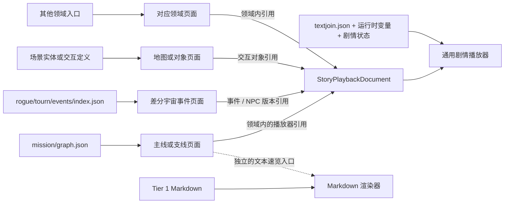

# Tier 2 剧情播放器展示数据结构设计

本文基于三个已有案例，设计一层面向用户回顾剧情的 Tier 2 播放数据：

- [Act100010162「定分枪」](../case-tests/act100010162/report.md)：顺序台词、角色条件分支、随机内容与隐藏副作用；
- [Chapter 105007「亏成首富」](../case-tests/chapter105007/report.md)：无演出图的 Markdown 速览、完整图中的嵌套选项、状态控制、汇合与回环；
- [模拟宇宙 / 差分宇宙事件对白](../case-tests/rogue-dialogue/report.md)：多种领域入口、三套选项文本关联、同正文不同版本和运行时回调。

本文只定义**具备完整演出图、选项和状态控制时使用的交互播放器数据**。无演出图时的 Tier 1 简略文本仍是独立的 Markdown 产物，不纳入本协议，也不包装成播放器的降级模式。

目标产物不是 GameCore 事件 IR 的消费端翻版，而是一份可回放的剧情脚本：查看器按顺序追加台词和必要的剧情摘要，遇到选项、随机结果或上下文差异时暂停；用户操作后沿对应路径继续。底层从哪一种业务入口触发、由哪种演出 task 播放、选项来自台词字典还是 Rogue 展示表，都不属于播放器的职责。

---

## 1. 首要边界

### 1.1 Tier 1 与 Tier 2 必须隔离

| | Tier 1 简略文本速览 | Tier 2 交互剧情播放器 |
|---|---|---|
| 数据前提 | 台词字典与任务归属线索 | 完整或足够还原的演出图、选项和控制边 |
| 产物 | Markdown | 本文定义的节点图 JSON |
| 渲染方式 | Markdown 渲染器 | 有状态的剧情播放器 |
| 分支 | 不还原；允许把选项摊平 | 必须保留选项、条件、随机、汇合与回环 |
| 状态 | 无 | 保存用户选择、动态变量、随机结果与回退点 |
| 数据缺失 | 仍可生成并阅读 | 不创建虚假的播放器文档 |

当前 `src/extract-dialogue-quick.mjs` 生成到 `output/dialogue/` 的内容属于 Tier 1。它可以从主线任务页面单独打开，由 Markdown 渲染器显示。Tier 1 不转换成 `StoryPlaybackDocument`，Tier 2 也不设置 `linear-fallback`、`linear-only` 等兼容分支。

二者可以在同一个业务页面中作为两个独立入口出现，例如“文本速览”和“剧情回顾”，但不能通过同一份数据的 mode 字段切换。这样可以避免简略文本的顺序近似、选项摊平等限制污染播放器协议。

### 1.2 不建立统一剧情入口索引

剧情入口属于各自领域，不能再套一层全局 `StoryCatalog`：

- 主线、开拓续闻、同行任务和支线已经由 `${lang}/mission/graph.json` 提供任务、章节、任务包与顺序；
- 差分宇宙事件图鉴已经由 `${lang}/rogue/tourn/events/index.json` 提供事件与不同版本的 NPC 配置入口；
- RogueMagicStory、TitanTalent、Formula 等保留各自独立的玩法入口；
- 定分枪这类演出由场景中的可交互 NPC、物品或 Prop 触发，应挂在对应场景实体或交互定义上；
- 其他资料、活动、关卡和玩法也由它们自己的现有列表或详情页进入。

播放器协议只提供可被这些入口引用的 `StoryPlaybackDocument`。它不负责把所有剧情重新收集、排序或分类，也不规定统一的剧情首页。

### 1.3 富文本只在渲染时解析

提取阶段必须保留 TextMap 得到的原始 HSR 文本，包括：

- `{NICKNAME}`；
- `{M#...}{F#...}` 性别分支；
- `{TEXTJOIN#n}`；
- `#{KEY}` / `{KEY}` 变量；
- `#1`、`#1[f2]%` 等位置参数；
- `{Img#1}`；
- `<unbreak>`、ruby、颜色、图标等 Unity / HSR 标签。

不得在提取阶段固定昵称、默认男性分支、TextJoin 默认项或 HTML。渲染时由消费端注入用户设置、语言、剧情状态与 TextJoin 当前值，不要求特定组件或状态管理实现。

这里所说的“不得预处理”指不得在剧情数据构建阶段把动态文本固化。运行时先替换 TextJoin，再处理 HSR 插值和 Unity 标签。

---

## 2. 总体数据流



共享发生在最后一段：不同入口找到相应的播放器文档后，共用同一种节点协议和播放器。入口发现、导航顺序、版本分类仍由原有领域数据负责。

---

## 3. 领域入口如何挂接播放器

### 3.1 使用三层 ID，不把源图 ID 当入口

需要明确区分三个层次：

| 层次 | 作用 | 示例 |
|---|---|---|
| 领域入口 ID | 用户从哪里点进来，由现有领域数据管理 | MainMissionID、EventHandbookID、场景实体组合键 |
| `flowId` | 一次可以从开头连续回放到语义终点的逻辑播放单元 | `mission:1040537`、`rogue-tourn-event:5:npc:410301:progress:0` |
| `NodeId` | flow 文档内部的台词、交互和控制节点 | `intro-1`、`choice-3`、`end` |

领域入口关联到 `flowId`，播放器加载对应文档后从该文档的 `entry: NodeId` 开始。Act、DS、Story、Opt、GroupGraph 文件名和 Performance 路径只是构建 flow 的来源，不作为用户入口 ID。

一个 flow 可以包含很多源图。解析器从具体触发点开始，沿已经确认的调用、信号、选项和任务推进边递归收集，直到该次交互或任务段的语义终点。跨文件不会产生新的 flowId。

反过来，一个高层领域条目可能包含多个互不连通的实际触发：

- 差分宇宙同一图鉴事件有多个 NPC 版本；
- 同一 NPC 的 `DialogueList` 可能按 `DialogueProgress` 提供多个阶段；
- 同一场景物品可能有不同交互状态或 Performance；
- 一个任务中可能存在无法证明先后关系的独立可选交互。

这时领域条目应挂接多个 `ScenarioPlaybackRef`。只有能够通过任务进度、显式控制边或领域顺序证明连续性的图，才合并进同一个 flow；无法证明顺序的部分不得仅因目录相近或 ID 相近而拼接。

`flowId` 的生成原则：

1. 使用领域命名空间，不能使用全局裸数字；
2. 由稳定的领域语义 ID 和具体触发槽组成；
3. 不使用 TalkSentenceID、首个图 ID 或文件路径作为 flowId；
4. 同一 flow 重新提取后保持稳定，便于回放进度和收藏迁移；
5. 源图增减只改变文档内容与 trace，不改变 flowId。
6. 不包含语言、数据快照或资源版本；不同语言的同一 flow 共用 ID，只加载不同语言的文档。

### 3.2 最小引用

本文只定义一个可选的最小引用，不规定它必须嵌入哪个现有类型：

```ts
type ScenarioFlowId = string;

interface ScenarioPlaybackRef {
  format: "hsr-scenario-player-v1";
  flowId: ScenarioFlowId;
  uri: string;
}
```

各领域可以选择：

- 直接在已有条目上增加可选引用；
- 在该领域自己的详情数据中增加引用；
- 使用只服务于该领域的 sidecar 映射；
- 在条目数量很少时直接内嵌播放器文档。

不允许新建一个跨 mission、Rogue、场景实体和活动的统一入口表。`uri` 只是加载文档的位置，不承担分类和排序。

`ScenarioPlaybackRef.flowId` 必须与目标 `StoryPlaybackDocument.id` 相同。一个领域条目可以持有一个或多个引用，并自行提供每个 flow 的标题、阶段名、版本名和顺序；这些展示字段不进入通用播放器协议。

### 3.3 主线、支线与章节

主线类入口继续使用 `${lang}/mission/graph.json`：

- `nodes` 提供任务；
- `combos` 提供章节和任务包；
- `edges` 提供主线追踪与解锁关系；
- 任务名称、描述、世界与章节归属继续以 `HsrMainMissionGraph` 为准。

播放器引用应挂在任务或该任务的领域详情上。通常以 MainMissionID 作为 flow 边界，例如任务 1040537 使用 `mission:1040537`。一个任务即使跨越多个 Act、DS、Story 或 Mission 图文件，也由解析器依据子任务进度、Performance 调用和控制边合并成一个连续回放；源文件边界不能变成新的用户入口。

如果同一 MainMission 内存在多个无法确认先后、也不共享状态的可选触发，则保留 `mission:<mainMissionId>:<triggerSlot>` 形式的多个 flow，由任务详情页分别展示，不能人为连接。

Tier 1 Markdown 的章节速览仍由主线模块单独打开，不作为播放器文档的替代值。

### 3.4 差分宇宙事件

差分宇宙事件继续使用 `${lang}/rogue/tourn/events/index.json`：

- `HsrRogueTournEvent` 是事件图鉴条目；
- `npcEntries` 保留事件关联的全部 NPC 版本；
- 每个 NPC 再经自己的 `npcJsonPath` 找到 DialogueList 中的 Act / Opt。

播放器引用应落在具体 NPC 版本的具体 `DialogueList` 阶段，而不是只落在事件标题上。推荐 flowId：

```text
rogue-tourn-event:<EventHandbookID>:npc:<RogueNPCID>:progress:<DialogueProgress>
```

`DialogueProgress` 未序列化时按该 NPC 的初始阶段 `0` 处理。当前快照的 316 个 `RogueTournNPC` 中有 40 个 NPC 包含多条 DialogueList，同一 NPC 内没有重复的有效 DialogueProgress，因此 `RogueNPCID + DialogueProgress` 可以稳定区分具体触发阶段。

410301、610301、710301 即使正文相同，也拥有不同 flowId，因为它们的选项和效果配置可能不同。`TalkNameID` 不能单独作为 flowId：同一 NPC 的多个 progress 可能复用 TalkNameID。

TitanTalent、Formula、MagicStory 等不属于该事件图鉴的入口，不能为了播放器而混入 `rogue/tourn/events/index.json`。

这些独立入口使用自己的领域 ID，例如：

```text
rogue-magic-story:53023
rogue-tourn-titan-talent:13002
```

从对应的 `LevelGraphPath` / `ActJson` 开始递归收集后续图；路径本身只进入 trace。

### 3.5 场景可交互对象

定分枪案例的真实触发入口是场景中的交互 Prop，`PerformanceE` 只帮助从演出 ID 定位 Act。播放器入口应由未来的场景实体、地图交互或对象详情数据挂接，而不是把 `PerformanceE` 行提升成面向用户的剧情目录。

场景实体 ID 必须包含其作用域，不能只用局部 PropID。推荐以 Plane / Floor / Group / Entity 组成 owner，再用具体交互 Performance 区分 flow：

```text
scene-prop:<PlaneID>:<FloorID>:<GroupID>:<PropID>:performance:<type>:<PerformanceID>
```

定分枪可使用：

```text
scene-prop:10001:10001001:102:300001:performance:E:100010162
```

如果未来的场景实体输出提供了更稳定的全局 interaction ID，应优先使用该 ID，组合键保留在 trace。PerformanceID 在这里是同一物品不同交互流程的触发槽，不是用户导航入口本身。

解析器仍可以通过 Performance、GroupGraph、Prop 和 Act 建立关联；这些关系只进入领域关联数据或 trace。用户从“定分枪”对象进入，播放器不显示 `PerformanceID=100010162` 或原始路径。

---

## 4. Tier 2 播放器文档

```ts
type NodeId = string;

interface StoryPlaybackDocument {
  schemaVersion: 1;
  id: ScenarioFlowId;
  locale: string;
  entry: NodeId;
  nodes: Record<NodeId, StoryNode>;
  inputs?: StoryInput[];
  richText: StoryRichTextRequirements;
  templates?: Record<string, StoryTemplateHint>;
}
```

文档不包含世界、章节、图鉴分类、优先级和封面等统一导航字段；这些信息由引用它的领域入口提供。`id` 就是领域引用中的 `flowId`，用于校验加载结果、回放存档和 trace 对应，不作为全站剧情索引。

### 4.1 输入

剧情控制可能依赖当前角色等播放器上下文。它们与全局富文本变量不是同一概念：

```ts
interface StoryInput {
  key: string;
  label: StoryRichText;
  type: "string" | "number" | "boolean" | "enum";
  required: boolean;
  default?: unknown;
  options?: Array<{
    value: unknown;
    label: StoryRichText;
  }>;
}
```

例如定分枪可以声明 `player.avatarId`。如果业务页面已经知道当前角色，直接传入；不知道时，播放器在首次需要该值的位置显示 context 交互。

`NICKNAME`、`playerGender` 和 TextJoin 不重复声明成 StoryInput，它们由现有 HSR 富文本运行时提供。

---

## 5. 富文本数据与运行时参数

### 5.1 文本必须保留原始语法

```ts
interface StoryRichText {
  /** TextMap 解析后的本地化原文；保留 HSR / Unity 语法。 */
  text: string;
  /** #1、#1[f2]%、{Img#1} 等语法使用的有序静态参数。 */
  params?: unknown[];
  /** 仅保存本节点已经确定的常量覆盖；不复制全局玩家设置。 */
  vars?: Record<string, unknown>;
}

interface StoryRichTextRequirements {
  format: "hsr-unity-source";
  usesNickname: boolean;
  usesPlayerGender: boolean;
  textJoinIds: number[];
  variableKeys: string[];
  usesPositionalParams: boolean;
}
```

`StoryRichTextRequirements` 是整份文档的依赖并集，用于预加载和诊断，不用于替换正文。具体文本始终携带自己的 `params` 和常量 `vars`。

示例：

```json
{
  "text": "定分枪的眼睛看着{NICKNAME}：「<unbreak>#1[i]</unbreak>分！」它宣布。",
  "params": [84]
}
```

提取器不能把它写成固定昵称、固定数值或 HTML。昵称、性别、TextJoin 和其他动态变量改变后，同一个节点应重新渲染。

### 5.2 静态参数来源

静态参数必须紧邻使用它们的文本保存，不能要求消费端回查原始配置：

| 文本语法 | 数据字段 | 获取方式 |
|---|---|---|
| `#1`、`#1[f2]%` | `StoryRichText.params` | 从源 task、配置行或效果展示行中语义已经确认的 ParamList 等字段按真实索引整理 |
| `{Img#1}` | `StoryRichText.params` | 同索引保存已经解析出的资源 URL；消费端仍执行 URL 校验和净化 |
| 节点内确定的 `{KEY}` / `#{KEY}` | `StoryRichText.vars` | 仅当值由当前分支或源配置明确给出时保存 |
| Unity 标签属性 | 保留在 `text` | 不在提取阶段转成 HTML |

如果参数无法获得，保留原始占位符并写入 trace 诊断，不能用零、空字符串或猜测值填充。Rogue 旧版的 `DescValue` 与模板 `#n` 并非总能按编号机械对应；只有领域 handler 已经确认映射时才能写入 `params`，否则同时保留模板和原始配置证据。

### 5.3 动态参数来源

数据协议只约定所需值及优先级，不绑定具体页面、组件或状态管理库：

| 动态内容 | 数据来源 | 渲染要求 |
|---|---|---|
| `{NICKNAME}` | 消费端提供的当前昵称 | 不写入剧情节点；渲染时读取当前值 |
| `{M#...}{F#...}` | 消费端提供的当前性别分支值 | 不提前选分支；值改变后重新渲染 |
| `{TEXTJOIN#id}` | 当前语言的 `textjoin.json` 和剧情中的 TextJoin 赋值 | 按默认项或剧情状态确定当前值 |
| 其他 `{KEY}` / `#{KEY}` | 运行时变量、剧情状态、节点 `vars` | 合并后解析；未知变量保留原文并报告诊断 |
| `#n` / `{Img#n}` | 当前 `StoryRichText.params` | 按原索引传入，不从全局状态猜测 |

`HsrTextJoin.defaultItemId` 决定默认文本，找不到时回退到第一项；消费端需允许用户设置或剧情状态覆盖当前值。

### 5.4 渲染与变量合并约定

渲染 `StoryRichText` 时，使用其原始 `text`、静态 `params` 和 `vars`，再注入当前运行时状态。变量合并优先级从低到高为：

```text
消费端运行时变量
  < 当前 playthrough 的剧情状态变量
  < 当前 StoryRichText.vars 常量覆盖
```

TextJoin 独立维护，不把 `TEXTJOIN#id` 当作普通 `vars` 覆盖。明确出现 `SetTextJoinValue` 等状态变化时，编译成隐藏的 TextJoin effect；播放时根据当前语言与赋值类型更新状态，并在下一条文本渲染前生效。

随后解析 HSR 插值和 Unity 标签；需要输出 HTML 的消费端负责安全渲染和资源 URL 校验。本协议不要求复用任何特定应用的渲染函数。

### 5.5 Tier 1 Markdown 的富文本

Tier 1 虽然只需要 Markdown 渲染器，也不能在构建时固定昵称、性别或 TextJoin。Markdown 产物保留原始 HSR 文本；消费端 Markdown 渲染器在输出台词内联内容时按相同的 HSR 文本语义渲染。

Tier 1 不因此获得剧情状态机：它仍然只是顺序 Markdown。遇到无法随 Markdown 携带的位置参数时，保留原始占位符并标注数据限制，不把 Tier 2 的节点、params 协议或状态控制塞进 Markdown。

---

## 6. 核心节点模型

播放器只需要识别五种节点，其中前三种可见，后两种只参与代码执行。

```ts
type StoryNode =
  | StoryLineNode
  | StorySummaryNode
  | StoryInteractionNode
  | StoryGateNode
  | StoryEndNode;

interface StoryNodeBase {
  id: NodeId;
  template?: string;
  quality?: "exact" | "inferred" | "partial";
}
```

### 6.1 `line`：台词、旁白与屏幕文字

```ts
interface StoryLineNode extends StoryNodeBase {
  kind: "line";
  role: "dialogue" | "narration" | "player" | "system";
  speaker?: {
    id?: string;
    name: StoryRichText;
    portrait?: StoryAsset;
  };
  content: StoryRichText;
  voice?: StoryAsset;
  next?: NodeId;
}
```

一条节点代表一次阅读单位。SimpleTalk、MissionTalk、NPC 气泡、Rogue Talk、Aeon Talk、由 DS 区间还原的 Timeline 正文最终都进入这一种结构。播放方式是否等待、原 task 子类是什么，不进入节点。

说话人名称也必须使用 `StoryRichText`，因为开拓者名称和部分称呼可能包含 `{NICKNAME}` 或性别语法。

### 6.2 `summary`：必须知道但无需复刻的演出

```ts
interface StorySummaryNode extends StoryNodeBase {
  kind: "summary";
  category:
    | "battle"
    | "video"
    | "challenge"
    | "scene-transition"
    | "reading"
    | "story-event";
  content: StoryRichText;
  asset?: StoryAsset;
  next?: NodeId;
}
```

摘要必须写用户能理解的剧情动作，而不是底层类型名：

- `参与“不要钱挑战”`；
- `与末日兽战斗`；
- `播放“白夜梦国记”剧情动画`；
- `进入“某某遗迹”副本`；
- `阅读“研究员的留言”`。

不要输出 `[TriggerBattle]`、`[RaidSceneTransfer]` 或 `[Timeline 演出]`。如果无法得到对象名，可以退化为“进入战斗”“播放剧情动画”；若连该事件是否影响剧情理解都无法判断，则只写入 trace。

### 6.3 `interaction`：统一播放器交互

```ts
interface StoryInteractionNode extends StoryNodeBase {
  kind: "interaction";
  mode: "choice" | "random" | "context";
  prompt?: StoryRichText;
  resolution:
    | { type: "user-choice" }
    | {
        type: "weighted-random";
        viewerDraws: 1;
        seedScope: "playthrough";
        revealAllAllowed: boolean;
      }
    | {
        type: "context-value";
        key: string;
        askWhenUnknown: boolean;
      };
  options: StoryInteractionOption[];
}

interface StoryInteractionOption {
  id: string;
  label?: StoryRichText;
  detail?: StoryRichText;
  weight?: number;
  when?: StoryCondition;
  effects?: StoryStateEffect[];
  next?: NodeId;
  routeStatus?: "resolved" | "unresolved";
}
```

- `choice`：显示当前可用选项，等待用户选择；
- `random`：用户触发后由播放器按权重选出一个结果并保存；“查看全部可能结果”是回顾页的附加能力；
- `context`：处理当前角色等剧情前提。已有业务上下文时自动选择，未知时才询问用户。

如果选项文本可解析但后续回调无法确认，保留选项并设 `routeStatus: "unresolved"`。选择后安全停止，不能按 ID 接近程度猜目标。

`random.viewerDraws = 1` 是回顾产品的一次播放规则，不声称等同于游戏引擎未序列化的 `RandomCount`。真实不确定性保留在 trace。

### 6.4 `gate`：隐藏条件路由

```ts
interface StoryGateNode extends StoryNodeBase {
  kind: "gate";
  rules: Array<{
    when: StoryCondition;
    next: NodeId;
  }>;
  otherwise?: NodeId;
}
```

`gate` 不渲染。播放器用业务上下文和此前交互产生的状态依次判断规则，然后继续到目标节点。如果必要输入未知且用户可以补充，解析器应生成 `context` 交互，而不是让 gate 静默失败。

条件表达式保持有限和声明式：

```ts
type StoryCondition =
  | { op: "eq"; key: string; value: unknown }
  | { op: "in"; key: string; values: unknown[] }
  | { op: "known"; key: string }
  | { op: "and" | "or"; args: StoryCondition[] }
  | { op: "not"; arg: StoryCondition };
```

### 6.5 隐藏状态 effect

```ts
type StoryStateEffect =
  | { op: "set-variable"; key: string; value: unknown }
  | { op: "unset-variable"; key: string }
  | {
      op: "set-text-join";
      textJoinId: number;
      value: StoryTextJoinValue;
    };

type StoryTextJoinValue =
  | { kind: "item"; itemId: number }
  | { kind: "text"; text: StoryRichText }
  | { kind: "variable"; key: string };
```

`set-variable` 影响后续 gate 或富文本变量。`set-text-join` 根据已确认的来源语义保存三类值：

- `item`：按 item ID 从当前语言已加载的 `HsrTextJoin.items` 取得文本；
- `text`：源配置明确提供的自定义文本，仍保留富文本语法；
- `variable`：在执行时读取剧情状态或业务上下文中的值，例如角色相关动态名称。

不能把 `SetTextJoinValue.Value` 一律当成 item ID。普通 TextJoin 中它可能表达候选序号，自定义文本或 Avatar 类型又有不同含义；解析器应结合 `HsrTextJoin.type` 和对应 handler 归一成上述值。无法确认时不生成可执行 effect，只把原值写入 trace。

不允许在 effect 中携带任意脚本、GameCore task 或不受限表达式。奖励结算、战斗执行和任务完成不属于剧情播放器 effect。

### 6.6 `end`：正常完成或断边

```ts
interface StoryEndNode extends StoryNodeBase {
  kind: "end";
  status: "complete" | "unresolved";
  message?: StoryRichText;
}
```

无演出图不是 `unresolved` end，而是不存在 Tier 2 文档、改走独立 Tier 1 Markdown。`unresolved` 只用于已经进入播放器后遇到的真实断边，例如 Rogue 选项有标题但无法确认运行时回调。

### 6.7 资源

```ts
interface StoryAsset {
  type: "image" | "video" | "audio";
  uri: string;
  title?: StoryRichText;
}
```

资源不可用不能阻断剧情。摘要节点始终有文字，视频、音频和立绘只是可选增强。若图片 URL 自身含 `{F#...}{M#...}`，应像现有 `SrRichImage` 一样在运行时按性别解析，不能提前固定路径。

---

## 7. 播放状态与页面行为

```ts
interface StoryPlaybackState {
  flowId: ScenarioFlowId;
  cursor: NodeId;
  variables: Record<string, unknown>;
  textJoinValues: Record<number, StoryTextJoinValue>;
  decisions: Array<{
    nodeId: NodeId;
    optionId: string;
  }>;
  transcript: NodeId[];
  randomSeed: string;
  completed: boolean;
}
```

最小执行规则：

1. 业务入口加载文档，并把已知上下文作为 inputs 传入；
2. 从 `entry` 开始；
3. 遇到 `gate` 时后台求值并继续，不生成页面内容；
4. 遇到 `line` / `summary` 时按当前富文本上下文渲染并追加到 transcript；
5. 遇到 `interaction` 时暂停，记录选择或随机结果，应用 effects，再沿该 option 的 `next` 前进；
6. 多条分支可指向同一节点形成汇合，公共正文只存一份；
7. option 可指回之前的 interaction 形成重试回环；
8. 回退到历史交互时，截断其后的 transcript、decisions、变量和 TextJoin 值，再从最近状态快照重放；
9. 同一次 playthrough 的随机结果固定；明确重新抽取时才更新；
10. 隐藏节点设置步数上限和无交互循环检测，防止坏数据卡死。

### 7.1 推荐页面形态

- 已读台词、旁白和剧情摘要按顺序保留；
- 当前 interaction 位于内容末尾，等待选择、抽取或补充上下文；
- 选择后把已选 option 作为玩家操作记录加入当前路径，未选项不混入 transcript；
- 随机节点只追加本次结果，“全部可能结果”从独立入口查看；
- 汇合后继续追加公共正文，不显示 CustomString 或技术性的汇合点；
- 点击历史交互可回退并重选，回退点之后的旧路径被替换；
- summary 与台词处于同一时间线中，但使用紧凑的事件卡样式。

播放器展示的是一条已经作出选择的剧情路径，而不是默认铺开整棵分支树。

---

## 8. 原始事件的展示处置

展示编译器对源事件采用五级处置。

| 处置 | 是否显示 | 是否进入播放器文档 | 用途与案例 |
|---|---:|---:|---|
| 正文 `line` | 是 | 是 | SimpleTalk、MissionTalk、Rogue/Aeon Talk、气泡、转场黑字、DS 正文 |
| 交互 `interaction` | 是 | 是 | OptionTalk、Rogue Option、角色上下文、RandomConfig |
| 摘要 `summary` | 是 | 是 | 战斗、PV、挑战、副本切换、阅读等剧情相关复杂演出 |
| 隐藏控制 | 否 | 是 | 条件路由、汇合、变量、TextJoin 状态和已确认控制边 |
| 丢弃 | 否 | 否 | 纯等待、朝向、镜头、显隐、HUD、音效、特效、生命周期 |

### 8.1 完整展示

- `PlaySimpleTalk` / `PlayAndWaitSimpleTalk` / `PlayMissionTalk`；
- `PlayRogueSimpleTalk` / `PlayAndWaitRogueSimpleTalk` / `PlayAeonTalk`；
- `PlayOptionTalk` / `PlayRogueOptionTalk` 及其选项载荷；
- `PlayNPCBubbleTalk`；
- `PlayFullScreenTransfer`；
- DS / Story 中通过锚点区间还原的 Timeline 正文。

这些来源的等待差异、Option 文本 join 方式和 task 子类名在编译后消失，但文本原文和 params 不变。

### 8.2 压缩成一句话

只有用户需要知道“故事中发生了这件事”时才生成摘要：

- `TriggerBattle` → “与……战斗”；
- `PlayVideo` 或明确的剧情媒体 → “播放……剧情动画”；
- `OpenTreasureChallenge` → “参与……挑战”；
- `RaidSceneTransfer` → “进入……副本/区域”；
- 阅读物或关键交互 → “阅读……/查看……”；
- 无对白但确实承载剧情结果的演出 → 用可理解的结果描述。

同一种底层类型不必永久属于同一种处置。Timeline 已还原出正文时不额外生成摘要；纯运镜 Timeline 丢弃；独立剧情 PV 才生成 `video` 摘要。

### 8.3 隐藏但保留

- 已确认的 `WaitCustomString` / `TriggerCustomString` 剧情边；
- 已确认的 `WaitDialogueEvent` 回调边；
- SwitchCase / Predicate 的条件语义；
- 分支汇合与回环；
- 影响后续展示的变量与 `SetTextJoinValue`；
- 必须追溯、但不应冒充剧情正文的外部关联。

隐藏数据编译成 `next`、`gate`、`when`、`effects` 或 trace，不生成“等待信号”“完成任务 #...”等页面行。

### 8.4 直接丢弃

- 等待固定时间、等待动画结束、等待对话播放完；
- 角色/实体面向、目标选择器；
- 创建、显隐、渐隐、碰撞和物件状态；
- 相机、滤镜、HUD、教程锁、加载策略；
- 音效、背景音状态、特效、普通角色动作；
- `LevelPerformanceInitialize`、`EndPerformance`、`WaitPerformanceEnd`、`FinishLevelGraph` 等生命周期外壳。

“丢弃”只表示不进入播放器文档；事件 IR 与覆盖诊断仍可统计它们。

---

## 9. 模板扩展

节点 `kind` 决定行为，`template` 只提供可选的视觉增强：

- `hsr.line.full-screen`；
- `hsr.summary.battle`；
- `hsr.summary.pv`；
- `hsr.interaction.dialogue-choice`；
- `hsr.interaction.rogue-option`。

```ts
interface StoryTemplateHint {
  baseKind: "line" | "summary" | "interaction";
  icon?: string;
  tone?: "neutral" | "danger" | "special";
  layout?: "default" | "compact" | "card";
}
```

兼容规则：

1. 每个节点仅凭核心字段即可阅读和操作；
2. 不认识模板的客户端按 `kind` 使用默认组件；
3. 模板不得改变 option 跳转、权重、条件、effects 或富文本参数；
4. 模板不得携带任意 JavaScript、组件路径或源 `$type`；
5. 来源差异不是新增模板的理由。旧 Opt 与 Excel Option 仍是相同 choice；
6. 新玩法优先复用五种核心节点，确有新用户行为时才提升 schemaVersion。

这样 Rogue 选项可以增加图标和效果说明，战斗摘要可以增加战斗样式，但最简单的播放器仍能完整工作。

---

## 10. 三个案例的映射

### 10.1 定分枪

```text
场景中的定分枪交互入口
  → 加载 StoryPlaybackDocument
      → line × 2
      → context：当前角色
          → 对应评分 line × 1～3
          → random：随机评论
              → 本次命中的 line
              → end
```

- 场景对象拥有入口，PerformanceE 和 Act 路径只用于解析与 trace；
- 角色条件统一为 `player.avatarId` 上下文或 gate；
- 四个角色共用一段评分时，多个 context option 指向同一个 line；
- 卢卡两个相同条件都保留。在 `WithBreak` 未确认前不能静默去重或选择其中之一；
- 开拓者特例不要求播放器理解 `ByLocalPlayerIsHero`；
- 11 条评论成为 random outcomes，权重保留；
- `100010162_Get/End`、等待播放完成和生命周期隐藏；
- 镜流外部任务与成就链放入 trace。产品若以后要展示成就，由领域功能选择性增加摘要，不改变主协议；
- `{NICKNAME}`、`<unbreak>` 与可能的参数原样保存，渲染时处理。

### 10.2 Chapter 105007 与 DS 代理任务

Chapter 105007 当前没有演出图，所以只有 Tier 1 Markdown：

- 使用任务顺序与句 ID 近似顺序；
- 允许选项摊平与部分旁白顺序偏差；
- 由 Markdown 渲染器展示；
- 不生成空的、线性的或标记为 fallback 的 StoryPlaybackDocument。

有完整图的代理任务 1040537 才进入 Tier 2：

```text
line × N
  → choice
      ├─ option A → line × N ─┐
      ├─ option B → line × N ─┼→ 公共 line
      └─ option C → nested choice / 回到上一个 choice
```

- `TalkSentence_*` 与 `Wait_Option_*` 只生成控制边，不显示成汇合点；
- 锚点区间恢复出的正文保留原始富文本，可标记 `quality: "inferred"`；
- 嵌套、回环和跨段汇合由 `next` 表达；
- 战斗、剧情视频、挑战和副本切换按需要生成一句 summary；
- `SetTextJoinValue` 等影响后续文本的状态操作生成隐藏 effect；
- 朝向、等待、HUD、音效和生命周期丢弃。

目标章节未来补齐演出图后，再生成独立的 Tier 2 文档；这不是对原 Markdown 产物的格式升级或替换。

### 10.3 模拟宇宙 / 差分宇宙

```text
各领域现有入口
  → 入口自己的 Act / Opt / NPC / Option 关联
  → StoryPlaybackDocument
      → line / choice / hidden edge
```

- 未来学大会和约束人德之法入口表不同，但加载文档后播放器结构相同；
- 图鉴事件的不同 NPC 版本各自挂接文档；
- 直接 TalkSentence、旧 Act+Opt、Excel Option 三条文本链统一为 option 的 `label`、`detail` 和 `params`；
- OptionIconType、效果说明可用 Rogue 模板增强，默认组件仍显示普通选项；
- 多个选项指向同一后续 sequence 时，共同 `next` 到同一节点；
- 410301 与 710301 保留为事件入口下的不同 NPC 版本，不由播放器建立全局 variant group；
- `WaitDialogueEvent` 只有在回调关系确认后才编译成边；不能确认时保留选项并安全断在 unresolved end；
- RogueOptionID、DisplayID、缺失 Opt、TextMap Hash 和入口表行只进入领域数据或 trace。

---

## 11. Trace 与不确定性

来源追溯独立于播放器文档：

```ts
interface StoryTrace {
  flowId: ScenarioFlowId;
  sourceSnapshot?: string;
  nodes: Record<NodeId, SourceReference[]>;
  unresolved: TraceDiagnostic[];
  coverage: Record<string, number>;
}

interface SourceReference {
  kind: string;
  locator: string;
  sourceId?: string;
}

interface TraceDiagnostic {
  code: string;
  severity: "info" | "warning" | "error";
  message: string;
  nodeId?: NodeId;
}
```

普通播放器不加载 StoryTrace。原始表、路径、JSON Pointer、TalkSentenceID、Hash、参数缺口、解析算法和置信度都保存在这里。

不确定情况按以下规则处理：

| 情况 | 处理 |
|---|---|
| 无演出图、只有文本顺序 | 只生成 Tier 1 Markdown |
| Tier 2 文本可靠、某条边不可得 | 保留文本与 option，目标为 unresolved end |
| 条件缺少运行时默认值 | 保留全部候选，使用 context 或 trace 说明，不擅自选择 |
| 随机权重存在、游戏抽取次数未知 | 播放器一次回放抽一个结果，trace 保留真实不确定性 |
| 富文本静态 params 缺失 | 保留原占位符并报告诊断 |
| 动态变量当前未知 | 交给运行时变量系统；未知语法保持原文 |
| 复杂事件语义可知、细节不可知 | 输出一句 summary |
| 对剧情理解无影响 | 丢弃 |
| 是否影响剧情无法判断 | 不进入正文，写入 trace 待分类 |

---

## 12. 解析器与消费端的责任

### 12.1 领域入口负责

- 提供自身的列表、分类、顺序和标题；
- 决定播放器引用挂在任务、事件版本、NPC、场景实体还是其他详情上；
- 决定是否同时提供独立 Tier 1 Markdown；
- 不把其他领域入口吸收到自己的列表中。

### 12.2 scenario-parser 负责

- 从领域提供的真实入口追踪演出数据；
- 合并台词、说话人、选项标题、效果说明及其静态 params；
- 保留未经预处理的 HSR 富文本；
- 还原正文顺序、分支、汇合、回环与可确认回调；
- 将复杂事件分类为正文、交互、摘要、隐藏或丢弃；
- 提取富文本依赖并生成 trace 诊断；
- 保证节点 ID 唯一、可达边目标存在、没有无交互死循环。

### 12.3 通用播放器负责

- 从业务页面接收 `ScenarioPlaybackRef`，而不是扫描统一剧情索引；
- 渲染 line、summary 和 interaction；
- 运行有限的 gate、condition 和 effect；
- 保存选择、剧情变量、TextJoin 当前值、随机种子、阅读进度和回退点；
- 使用当前语言的 `textjoin.json`、运行时变量和剧情状态动态渲染富文本；
- 为未知模板提供默认渲染；
- 对 unresolved 安全停止；
- 可选地提供全部分支和 trace 调试视图。

播放器不读取 Excel、Act、Opt 或 TextMap，不按 ID 猜关联，也不根据 `$type` 选择组件。

---

## 13. 验收标准

正式落地时至少验证：

1. Tier 1 仍是独立 Markdown，不经过播放器 JSON，也不拥有播放器状态机；
2. Chapter 105007 缺图时不会生成虚假的 Tier 2 文档；
3. mission、差分宇宙事件和场景交互对象分别从自己的现有入口打开剧情，不存在全局 StoryCatalog；
4. 领域入口关联的是稳定 flowId，任何 flowId 都不直接等于首个 Act / DS / Story 文件名；
5. MainMission 1040537 的多个演出块能聚合在 `mission:1040537` 中，新增或减少源图不改变 flowId；
6. 差分事件的不同 NPC 与 DialogueProgress、同一物品的不同交互 Performance 不会错误共用 flowId；
7. 同一套播放器在文档加载后可以播放定分枪、DS 代理任务和 8 个 Rogue 样本；
8. 台词保留 `{NICKNAME}`、性别、TextJoin、Unity 标签和位置参数原文；
9. 修改昵称、性别或 TextJoin 后，已经存在的剧情节点能按当前状态重新渲染；
10. 每条使用 `#n` / `{Img#n}` 的文本都携带对应 params，缺失时有 trace 诊断；
11. 选择后只出现对应后续，回退重选会重建变量与 TextJoin 状态；
12. 多个选项汇合到同一段正文时，公共正文只存一份、只显示一次；
13. `Wait_Option_*` 回环能返回此前选项，不造成无限自动循环；
14. 定分枪可按角色上下文得到对应评分，并产生一个稳定的随机评论；
15. Rogue 三种选项文本来源在播放器节点上没有结构差异；
16. 410301 与 710301 的选项不会因为正文相同而合并；
17. 战斗、PV、挑战等只显示用户能理解的一句话；等待、朝向和生命周期不出现；
18. 未解析回调安全停止并留有 trace，不通过编号猜边；
19. 删除 StoryTrace 后，领域入口与 StoryPlaybackDocument 仍足以完成普通剧情回顾。

满足这些条件后，共享的只是“进入剧情之后如何播放”，而不是强行统一所有剧情入口；Tier 1 与 Tier 2 保持清晰边界，富文本仍按当前运行时状态动态渲染。
